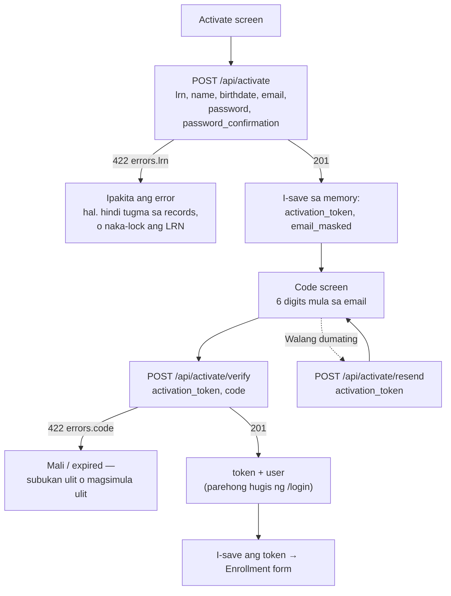
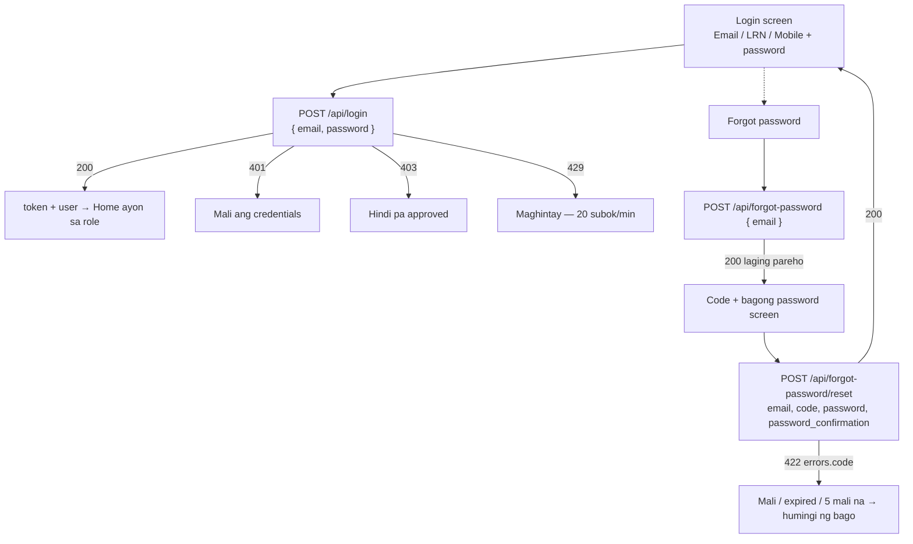
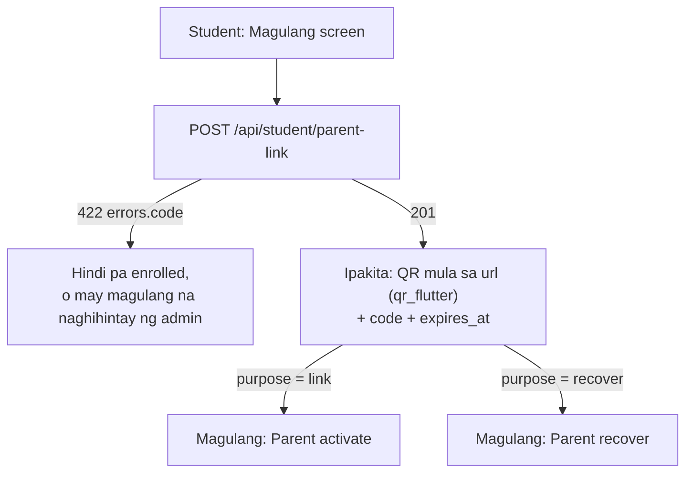
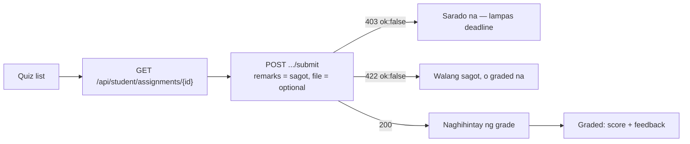
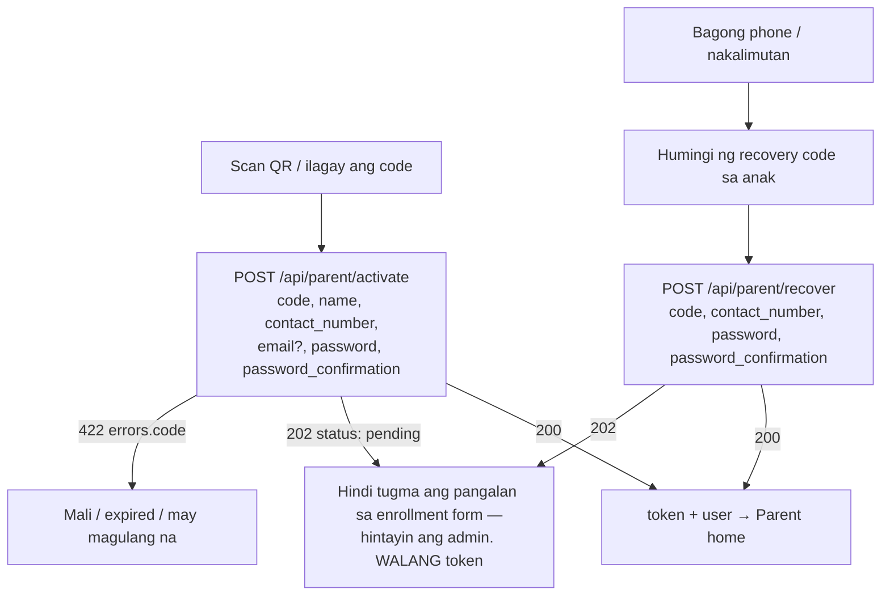
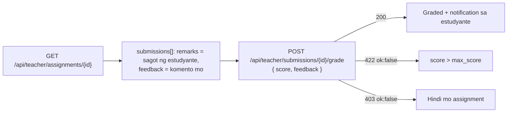
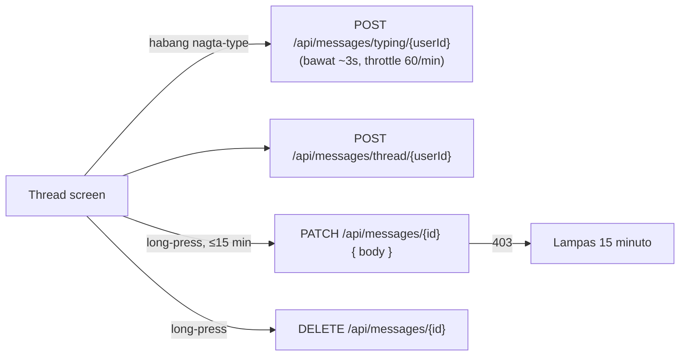

# DP-LMS — Backend changes para sa Flutter app

Para sa: developer (o Claude Code session) na gumagawa sa Flutter repo (`dp_lms`).
Backend repo: `dp-lms-web` (Laravel 12), branch `feature/parent-link`.

> Ang flowcharts ay Mermaid — nire-render ng GitHub at ng VS Code
> (extension: "Markdown Preview Mermaid Support").
>
> **Kasamang dokumento:** `IOT_ARRIVAL_NOTIFICATIONS.md` — Raspberry Pi scan → push sa magulang,
> `GET /api/notifications`, `GET /api/parent/attendance`.
>
> **Lahat ng mensahe ng server ay English na.** Ipakita ang `message` / `errors.*` mula sa server
> nang direkta — huwag mag-hardcode ng sariling bersyon.

---

## 0. Pangkalahatang tuntunin sa API

| Bagay | Halaga |
|---|---|
| Base URL | `{APP_URL}/api` |
| Auth | `Authorization: Bearer {token}` (Laravel Sanctum) |
| **Laging ipadala** | `Accept: application/json` — kung wala, redirect (302) ang validation error imbes na JSON |
| Password rule (lahat) | min 8, may malaki at maliit na letra, numero, at simbolo |
| JSON key ng login | `email` pa rin (**huwag palitan**) — tumatanggap ng email, LRN, o mobile |

### Hugis ng error

| Status | Kailan | Body |
|---|---|---|
| `422` | Validation | `{ "message": "...", "errors": { "field": ["mensahe"] } }` |
| `401` | Walang/expired na token, o maling login | `{ "message": "..." }` |
| `403` / `404` / `422` | Bawal ang aksyon (hal. sarado na ang quiz) | `{ "ok": false, "message": "..." }` |
| `410` | Tinanggal na endpoint (`/register`) | `{ "message": "..." }` |
| `429` | Rate limit | `{ "message": "Too Many Attempts." }` |

---

## 1. Buod ng mga pagbabago

### ⚠️ Breaking (kailangang baguhin ang app)

| Endpoint | Dati | Ngayon |
|---|---|---|
| `POST /api/register` | Gumagawa ng account | **`410 Gone`** — gamitin ang `/api/activate` (estudyante) o `/api/parent/activate` (magulang) |
| `POST /api/student/enroll` | Halos walang validation sa pangalan ng magulang | Kaparehong rules ng web (tingnan §4.4). `422` kapag enrolled na sa school year na ito |
| `POST /api/teacher/submissions/{id}/grade` | `remarks` = feedback (pinapalitan ang sagot ng estudyante) | **`feedback`** na ang field. Tinatanggap pa ang `remarks` bilang fallback, pero sa `feedback` column na nase-save |
| `POST /api/teacher/grades` | Puwedeng i-grade ang kahit sinong user | `403` kapag hindi itinuturo ng teacher ang subject sa section ng estudyante |
| `POST /api/teacher/announcements` | Kahit anong `section_id` | Sariling section lang, kung hindi `422 errors.section_id` |
| `POST /api/student/materials/{id}/*` | Kahit anong material | `404` kapag hindi published o hindi sa section ng estudyante |

### ✅ Bago

| Endpoint | Gamit |
|---|---|
| `POST /api/activate` · `/activate/verify` · `/activate/resend` | Unang beses na pag-activate ng student account |
| `POST /api/forgot-password` · `/forgot-password/reset` | Tunay na forgot password (dati stub — walang ipinapadala) |
| `POST /api/parent/activate` · `/api/parent/recover` | Parent account gamit ang code mula sa anak |
| `POST /api/student/parent-link` | Estudyante: gumawa ng code/QR para sa magulang |
| `POST /api/messages/typing/{user}` · `PATCH /api/messages/{id}` · `DELETE /api/messages/{id}` | Typing, edit, unsend — **dati may method pero walang route (404)** |
| `GET /api/notifications` · `POST /api/notifications/{id}/read` · `/read-all` | Notification inbox (lahat ng role) — tingnan ang IoT doc |
| `GET /api/parent/attendance?days=30` | Arrival history ng anak (Raspberry Pi scans) |

### ➕ Additive (hindi masisira ang dating code)

- `GET /api/student/assignments/{id}` → `submission.feedback`
- `GET /api/teacher/assignments/{id}` → `submissions[].feedback`
- `GET /api/student/grades` → `school_year`
- Announcements (student/parent) — school-wide + para sa sariling section lang
- Teacher dashboard / students / attendance — kasama na ang **advisory** class

---

## 2. Student activation (pamalit sa register)



### `POST /api/activate` (throttle 20/min)

```json
{
  "lrn": "101953190033",
  "name": "Ajhay Esmeralda Agoc",
  "birthdate": "2013-03-15",
  "email": "ajhay@gmail.com",
  "password": "Secret#123",
  "password_confirmation": "Secret#123"
}
```

| Response | Body |
|---|---|
| `201` | `{ "message", "activation_token": "48 chars", "email_masked": "aj•••@gmail.com", "expires_at": "ISO-8601" }` |
| `422 errors.lrn` | Hindi tugma ang LRN at pangalan **(iisang mensahe para sa maling LRN at maling pangalan — sinadya)**, naka-lock (5 mali/oras, 10/araw), o may account na |
| `422 errors.email` | Gamit na ang email, o hindi maipadala ang code |

- `name` — dapat tugma sa masterlist (hindi mahalaga ang ayos, laki ng letra, o accent: "Peña" = "Pena").
- `birthdate` — `YYYY-MM-DD`, hindi bababa sa 8 taong gulang.
- **Walang account na nagagawa sa hakbang na ito.** Ang token ay valid nang 10 minuto.

### `POST /api/activate/verify` (throttle 20/min)

`{ "activation_token": "...", "code": "123456" }`

| Response | Body |
|---|---|
| `201` | `{ "message": "Account activated.", "token", "user": { id, name, email, role, grade_level, status } }` |
| `422 errors.code` | Mali (5 subok), expired, o may nauna nang nag-activate |

### `POST /api/activate/resend` (throttle 5/10 min)

`{ "activation_token": "..." }` → `200 { "message" }`. Hanggang 3 beses; bagong code at bagong 10 minuto.

> Pagkatapos mag-activate, **walang section** pa ang estudyante → walang subjects/modules/grades
> hanggang ma-approve ng adviser ang enrollment form. Ipakita ang enrollment form agad.

---

## 3. Login, forgot password



### `POST /api/login` (throttle 20/min)

`{ "email": "<email | 12-digit LRN | 09XXXXXXXXX>", "password": "..." }`

- `200` → `{ "token", "user": { id, name, email, role, grade_level, status } }`
- Mobile: tinatanggap ang `+63 917 123 4567`, `09171234567`, atbp. Ang **12-digit na purong numero ay LRN**.
- **Walang OTP** sa mobile login (hindi nagbago).

### `POST /api/forgot-password` (throttle 10/min)

`{ "email": "..." }` → `200 { "message", "expires_minutes": 10 }` — **pareho ang sagot may account man o wala**. `429` kapag lampas sa 3 kada 5 minuto para sa iisang email.

### `POST /api/forgot-password/reset` (throttle 20/min)

`{ "email", "code", "password", "password_confirmation" }` → `200 { "message" }`.
Pagkatapos: **lahat ng dating token ng user ay buburahin** (mala-logout sa ibang device).

---

## 4. Estudyante

### 4.1 Magulang (parent link)



`POST /api/student/parent-link` (throttle 10/10 min) →

```json
{
  "code": "M4MD-589A",
  "purpose": "link",
  "expires_at": "2026-10-21T08:00:00+08:00",
  "url": "https://.../parent/activate?code=M4MD-589A"
}
```

- `purpose: "link"` kapag wala pang magulang; `"recover"` kapag mayroon na (para sa bagong phone / nakalimutang password).
- Valid nang **24 oras, isang beses lang**. Ang bagong code ay pumapatay sa luma.
- Ang `url` ay web page din — puwedeng i-scan ng kahit anong camera app.

### 4.2 Quizzes / assignments



`GET /api/student/assignments/{id}` → `submission`: `{ id, file_url, remarks (sagot mo), feedback (komento ng teacher — BAGO), score, status, submitted_at }`

### 4.3 Materials

`/api/student/materials/{id}` (detail/view/like/comments) — `404` na kapag ang material ay hindi published o hindi itinuturo sa section ng estudyante. Gamitin lang ang mga ID mula sa `GET /api/student/modules`.

### 4.4 Enrollment — `POST /api/student/enroll`

| Field | Rule |
|---|---|
| `student_type` | required: `new` / `old` / `transfer` |
| `full_name` | required, letra lang (pinapayagan ang ñ, tuldok, gitling, apostrophe) |
| `age` | required, 10–25 |
| `birthdate` | required, `YYYY-MM-DD`, bago ngayong araw |
| `gender` | required: `Male` / `Female` |
| `address` | required, max 500 |
| `mother_name`, `father_name`, `guardian_name` | optional, letra lang — **ito ang ikukumpara kapag nag-link ang magulang** |
| `guardian_contact` | optional, numero/`+`/`-`/espasyo, max 20 |
| `last_school`, `last_grade_completed` | optional (dati hindi nase-save sa API — ngayon oo) |
| `general_average` | **BAGO (2026-10-21)** — optional, number `60`–`100` (hal. `88.5`). General average noong nakaraang school year (Form 138). Ginagamit ng adviser/admin para balanse ang sections (heterogeneous). Label sa app: "General Average last school year (optional)" |

`422 errors.student_type` = "already enrolled for this school year".

### 4.5 Announcements, grades

- `GET /api/student/announcements` at `dashboard.announcements` — school-wide + para sa section mo lang.
- `GET /api/student/grades` — may `school_year` na bawat row.

---

## 5. Magulang



### `POST /api/parent/activate` (throttle 30/min)

```json
{
  "code": "M4MD-589A",
  "name": "Maria Santos Dela Cruz",
  "contact_number": "09171234567",
  "email": null,
  "password": "Secret#123",
  "password_confirmation": "Secret#123"
}
```

| Response | Body |
|---|---|
| `200` | `{ "message": "Account created.", "token", "user" }` — tugma ang pangalan sa mother/father/guardian ng anak |
| `202` | `{ "message", "status": "pending" }` — hindi tugma; **walang token**, hintayin ang admin |
| `422` | `errors.code` (mali/expired/may magulang na), `errors.contact_number` (format o gamit na), `errors.email`, `errors.name` (dapat buong pangalan) |

- `code`: tinatanggap ang `M4MD-589A`, `m4md589a`, atbp.
- `contact_number`: `09XXXXXXXXX` o `+63…` (ginagawang `09…` ng server).
- `email` optional. Kung wala, ang **mobile number** ang pang-login.

### `POST /api/parent/recover` (throttle 30/min)

`{ "code", "contact_number", "password", "password_confirmation" }` → `200 { "message": "Password updated.", "token", "user" }` o `202` (pending).
Pinapatay ang lahat ng dating token ng magulang.

---

## 6. Teacher

### 6.1 Pag-grade ng submission



### 6.2 Grades — `POST /api/teacher/grades`

Body (hindi nagbago): `{ student_id, subject_id, quarter: Q1–Q4, written_works?, performance_tasks?, quarterly_assessment? }`
- `403 { message }` — hindi itinuturo ng teacher ang subject sa **section ng estudyante**.
- `422 { message }` — hindi estudyante ang `student_id`.
- Isang grade kada estudyante × subject × quarter × **school year** (hindi na napapalitan ang grade ng nakaraang taon).

### 6.3 Announcements — `POST /api/teacher/announcements`

`{ title, body (max 20000), audience: all|students|parents, section_id? }` — ang `section_id` ay dapat isa sa sariling section (subject o advisory).

### 6.4 Students, dashboard, attendance

Kasama na ang mga estudyante ng **advisory section** (dati subject sections lang).

---

## 7. Chat (student ↔ teacher)



| Endpoint | Body | Response |
|---|---|---|
| `POST /api/messages/typing/{userId}` | — | `{ ok: true }` |
| `PATCH /api/messages/{id}` | `{ body }` (max 2000) | `{ ok: true, message: { id, body, edited: true } }` · `403` kapag lampas 15 min |
| `DELETE /api/messages/{id}` | — | `{ ok: true }` (sariling message lang) |

`GET /api/messages/thread/{userId}` ay may `peer_typing`, at bawat message ay may `edited` at `can_edit`.

### Bad-word filter (bago)

Ang **send**, **edit** ng chat at ang **material comment** ay tinatanggihan kapag may mura:
`422 { "message": "...", "errors": { "body": ["Please avoid inappropriate language."] } }`

- Buong salita ang tsine-check — hindi nahaharang ang "gagawin", "computation", "leche flan".
- Nahuhuli: `g@g0`, `p.u.t.a`, `p u t a`, `putaaa`, `gagong`, `fucking`.
- Ipakita ang `errors.body[0]` sa ilalim ng input; **huwag burahin ang tinype** para maitama ng user.

---

## 8. IoT (Raspberry Pi / ESP32) — para sa `config.py` ng Pi

| Endpoint | Pagbabago |
|---|---|
| `POST /api/attendance` | Isang record lang kada estudyante kada araw. Ang pangalawang scan ay `200 { success: true, message: "Attendance already recorded today.", status }`. May `status` na rin (`present`/`late`) ang response |
| `GET /api/attendance` | **Kailangan na ng `X-Device-Key`** at piling field na lang ang ibinabalik (dati: buong user record, walang auth) |
| `GET /api/faces/approved` | Walang pagbabago |

Lahat ay may `X-Device-Key` (dapat kapareho ng `ATTENDANCE_DEVICE_KEY` sa server), throttle 120/min.

---

## 8.1 Face registration — KIOSK ONLY na (2026-10-21)

Hindi na nagre-register ng mukha ang estudyante sa phone. Ang **adviser** ang nagpapakita ng one-time QR,
at sa **Raspberry Pi kiosk** kinukunan ang mukha (tingnan `RASPBERRY_PI_FACE_KIOSK.md`). Dahilan: mas secure
(nakikita ng adviser kung sino talaga ang nasa camera — walang ibang mukha sa account ng iba) at walang
admin review queue.

| Endpoint | Ngayon |
|---|---|
| `GET /api/student/face` | Gumagana pa. Bagong fields: `self_upload` (`false`) at `how_to` (text na ipapakita) |
| `POST /api/student/face` | **`403 { ok:false, message: "Face registration is done at the school kiosk. Ask your adviser to register your face." }`** habang `self_upload` = false |

Sa app: kapag `self_upload` = `false`, **itago ang camera/upload screen** at ipakita na lang ang status:
`status = approved` → "Your face is registered ✓"; kung hindi → ipakita ang `how_to`. Ang server
setting ay `FACE_SELF_UPLOAD` (default `false`) — kapag ginawang `true`, babalik ang dating upload flow.

## 9. Checklist para sa Flutter

- [ ] Ipadala ang `Accept: application/json` sa **lahat** ng request
- [ ] Palitan ang **Register** screen → **Activate** (2 hakbang: form → 6-digit code). `activation_token` sa memory lang
- [ ] Login label: "Email, LRN, o Mobile number" (key ay `email` pa rin)
- [ ] **Forgot password**: 2 screen (email → code + bagong password)
- [ ] Student **"Magulang"** screen: `POST /api/student/parent-link`, QR mula sa `url` (`qr_flutter`), code + countdown
- [ ] Parent **activate** screen: scan QR (`mobile_scanner`) → kunin ang `code` query param, o i-type ang code
- [ ] Parent **recover** screen
- [ ] Hawakan ang `202 { status: "pending" }` sa parent activate/recover (walang token)
- [ ] Chat: ikabit ang typing / edit / unsend sa mga bagong route
- [ ] Chat + comments: ipakita ang `422 errors.body` (bad-word filter) nang hindi binubura ang tinype
- [ ] Quiz detail (student): ipakita ang `feedback`; teacher grading: ipadala ang `feedback`
- [ ] Enrollment form: client-side validation na tugma sa §4.4
- [ ] Teacher announcement form: piliin lang ang sariling sections
