# Flutter app: everything in one prompt

> Paste this whole file into the Claude Code session of the Flutter project (`dp_lms`), or copy it into that project's `docs/`
> folder and point the session to it. Backend: Laravel `dp-lms-web`, branch `feature/ui-refresh`.
> Last combined on 2026-11-06.

**How to use this file**

1. Check what the app already has, and list what is missing before writing code.
2. Skip anything already built and working. Do not rebuild it.
3. Do Part 1 first, then Part 2, then the rest in the order under "Work in this order".
4. **The parts run newest first. When two parts disagree, the lower part number wins.** Three older rules that changed:
   - The login now asks for an email code (Part 1). An older part may say there is no OTP on mobile login.
   - Class attendance has no code; the student checks in with one tap (Part 3, section 5). Part 6 still describes the old code.
   - Grades use the percentages of their class and quarter (Part 2). Never hard-code 25, 50 and 25.

The source file names below are only labels: everything they contain is already in this file.

| Part | Covers | Source file |
|---|---|---|
| 1 | Email code at login | `FLUTTER_PROMPT_LOGIN_OTP.md` |
| 2 | Google Meet and grade percentages | `FLUTTER_PROMPT_MEET_WEIGHTS.md` |
| 3 | Teachers who left, names, notifications, one-tap attendance | `FLUTTER_PROMPT_SEMESTER_LEAVE_NAMES.md` |
| 4 | Going live with the real lists | `FLUTTER_PROMPT_GO_LIVE.md` |
| 5 | Terms, teacher activation, enrollment status | `FLUTTER_PROMPT_TERMS_TEACHER_ENROLLMENT.md` |
| 6 | Class attendance | `FLUTTER_PROMPT_CLASS_ATTENDANCE.md` |
| 7 | Face registration QR | `FLUTTER_PROMPT_FACE_KIOSK_QR.md` |
| 8 | Parent arrival notification | `FLUTTER_PROMPT_PARENT_ARRIVAL.md` |
| 9 | Backend handoff | `FLUTTER_HANDOFF.md` |
| 10 | Reference: Raspberry Pi to parent | `IOT_ARRIVAL_NOTIFICATIONS.md` |

---

## 0. Ground rules

1. **The server is the source of truth.** Use only the endpoints and JSON fields written in the documents
   below. If the app calls something that is not there, or a field is missing, stop and list it in your
   report instead of guessing or adding a workaround.
2. **Search before you write.** Look for existing services, models, screens and packages
   (`firebase_messaging`, `flutter_local_notifications`, the HTTP client, the auth/token store) and extend
   them. Do not create a second HTTP client, a second FCM setup or duplicate models.
3. **Send `Accept: application/json` on every request** and `Authorization: Bearer <token>` on every
   protected one.
4. **Show the server's own messages.** Every error has `message` and, for validation, `errors.<field>`.
   Display them as they are; do not hardcode your own wording.
5. Follow the project's existing state management, folder structure and naming.

---

## 2. Work in this order

**P0. Session handling** (everything else depends on it)
- `401` on any protected call: the token is gone (logged out elsewhere, or the account was **recovered
  on another device** — recovery now ends every older login). Clear the stored token and go to login.
- `403 { "message": "Your account is not active. Please contact the school." }`: the account was rejected
  or banned while signed in. The server already deleted the token. Clear it and go to login with that message.
- Logout, in this order: `DELETE /api/fcm-token` → `POST /api/logout` → clear the token, cached user and
  any cached screens → open a **fresh** login screen with empty fields. If either call fails (offline),
  still clear everything locally.

**P0. Parent arrival notification** — all of Part 8.
- Register the FCM token right after login **and** on every token refresh (`POST /api/fcm-token`).
- The push must work with the app in the foreground, background and closed.
- Tapping it opens the child's arrival history.

**P1. Face registration screen (student)** — Part 9 §8.1.
- Faces are registered only at the school kiosk with the adviser. When `GET /api/student/face` returns
  `self_upload: false`, hide the camera/upload screen and show only the status (`approved` → registered;
  otherwise show the server's `how_to` text).

**P1. Face registration QR (teacher)** — all of Part 7.

**P1. Class attendance** — all of Part 6.

**P2. The rest of the checklist** in Part 9 §9.

---

## 4. Done means

- [ ] Every item in `FLUTTER_HANDOFF.md` §9 works against the real server (not mocks).
- [ ] Parent phone receives the arrival push within a few seconds of `POST /api/attendance`, with the app
      in foreground, background and closed; tapping it opens the arrival history.
- [ ] Logging out then pressing Back never shows the previous account or its typed password.
- [ ] Recovering a parent account on phone B sends phone A to the login screen on its next request.
- [ ] Every error shown to the user is the server's `message` / `errors.*` text.

## 5. Report back

When you finish, write a short report with:
1. What was implemented, per section above.
2. Any endpoint or field the app needs that is **not** in these documents (name, method, why).
3. Anything in these documents that did not match the real server response (paste the response).

---

# Part 1: Email code at login

## Task for the Flutter app: email code at login

> Backend: Laravel `dp-lms-web`, branch `feature/ui-refresh`. Everything below runs on the local server and is covered
> by automated tests (2026-11-06). Goal: the app signs in the same way as the website.

Until now the app signed in with the password alone. Now a correct password sends a 6-digit code to the person's email,
and the app gets its token only after that code is entered. This replaces "no OTP on mobile login" in `FLUTTER_HANDOFF.md`.

The server sends the email. **The app needs no email package, no API key and no mail settings.** It only needs one new screen.

---

### 0. Before writing code

1. Search the project for the login screen, the API client, the token store and what runs after login (FCM token, Terms
   screen). Extend them; do not duplicate.
2. Show server messages as they come (`message`, or the first item of `errors.<field>`).

---

### 1. The new login

#### `POST /api/login`

```json
{ "email": "<email, 12-digit LRN or 09XXXXXXXXX>", "password": "...", "device_token": "<saved token, if any>" }
```

| Answer | Meaning | What the app does |
|---|---|---|
| `200` with `token` and `user` | Signed in. This phone is remembered. | Same as before: save the token, register FCM, check Terms. |
| `200` with `otp_required: true` | Password is right, code sent | Open the code screen |
| `401` | Wrong login or password | Show `message` |
| `403` with `status: "new_device"` | A parent with no email, on a new phone | Show `message` and a button to Parent recovery |
| `403` with another `status`, or no `status` | Not approved, inactive, or temporary password | Show `message` |
| `429` | Too many wrong passwords (5 tries, 30 minutes) | Show `message` |

The code answer:

```json
{ "otp_required": true, "otp_token": "…", "email_hint": "j***@gmail.com", "expires_in": 300, "message": "We sent a 6-digit code to your email." }
```

Always check `otp_required` first. A `200` no longer means there is a `token`.

#### Code screen

- Title: **Check your email**. Text: "We sent a 6-digit code to `email_hint`."
- A 6-digit number field with `AutofillHints.oneTimeCode`, so pasting and auto-fill work.
- A countdown from `expires_in`.
- A checkbox, off by default: **Remember this phone for 30 days**. Below it: "Do not check this on a shared phone."
- **Send a new code**, available 60 seconds after the last one.
- A hint: "Didn't get it? Check your spam folder."
- **Back to sign in**, which drops the `otp_token`.

#### `POST /api/login/verify`

```json
{ "otp_token": "…", "code": "482913", "remember_device": true }
```

| Answer | What the app does |
|---|---|
| `200` with `token`, `user`, and `device_token` if asked | Same as a normal login. Save `device_token` (part 2). |
| `422` with `errors.code` | Wrong or expired code: show it under the field and stay on the screen |
| `422` with `message` and no `errors` | The login expired: show it and go back to sign in |
| `429` | Too many tries: show `message` and go back to sign in |
| `403` | The account was blocked meanwhile: show `message` and go back to sign in |

#### `POST /api/login/resend`

```json
{ "otp_token": "…" }
```

`200 { "message": "We sent a new code to your email.", "expires_in": 300 }`. Restart the countdown. The old code stops working.
`429` means too many codes were sent (5 an hour): show `message` and stay, because the last code still works.
`422` means the login expired: go back to sign in.

**Security:** keep `otp_token` in memory only, and never log the code, `otp_token` or `device_token`.

---

### 2. Remembered phones

- Save `device_token` in secure storage (`flutter_secure_storage`), never in plain preferences.
- Key it by the login text. A parent and child often share one phone, so one phone can hold more than one token.
- Send it as `device_token` in `POST /api/login` for that same login.
- **Keep it on logout**, so the next login on this phone needs no code.
- It lasts 30 days. If it expired or was cancelled, the server simply asks for a code. Save the new one if a new one comes.
- A password change or account recovery cancels it on the server. Nothing special is needed in the app.

---

### 3. Parents

`POST /api/parent/activate` and `POST /api/parent/recover` now also answer with `device_token`. **Save it** as in part 2,
using the mobile number as the key. Many parents have no email, so this token is what lets them sign in again on this phone.

On a new phone, or after 30 days, a parent with no email gets `403` with `status: "new_device"`. Open Parent recovery, where
they use the code from their child's account. A parent who has an email gets the normal code screen.

---

### 4. For testing

- Local server: with `MAIL_MAILER=log` the code is not sent. Get one with `php artisan demo:otp <login>`.
- The server has a switch, `API_LOGIN_OTP`. It is on by default. With `API_LOGIN_OTP=false`, `/api/login` answers with the
  `token` directly, as it did before. The website team keeps it off only until this update is in the released app.
- Handle both answers from `/api/login`. Do not remove the normal `token` case.

---

### 5. Checklist

- [ ] Right password shows the code screen with the masked email.
- [ ] Right code signs in, and FCM and Terms run the same as before.
- [ ] Wrong code shows the error and stays on the screen.
- [ ] Send a new code works, and the old code is refused.
- [ ] Remember this phone: logging out and in again asks for no code.
- [ ] Without it, the next login asks for a code.
- [ ] A parent with no email signs in on the activated phone, and sees Parent recovery on a new phone.
- [ ] `otp_token`, `device_token` and codes never appear in logs.

---

# Part 2: Google Meet and grade percentages

## Task for the Flutter app: Google Meet links and grade percentages

> Backend: Laravel `dp-lms-web`, branch `feature/ui-refresh`. Everything below runs on the local server and is covered
> by automated tests (2026-11-05). Goal: the app behaves the same as the website.

---

### 0. Before writing code

1. Search the project for the student dashboard, the teacher gradebook, the grades models, the notification inbox and
   the API client. Extend them; do not duplicate.
2. Show server messages as they come (`message`, or the first item of `errors.<field>`).
3. All changes on the server are additions, so an app that is not updated yet keeps working.

---

### 1. Google Meet links

There is one link for each subject of a section. The teacher assigned to that class manages it.

#### Student

`GET /api/student/meet-links` returns the links of the student's own section this term. It can be empty.

```json
[
  { "id": 12, "subject": "Science", "teacher": "Dela Cruz, Juan", "url": "https://meet.google.com/abc-defg-hij", "updated_at": "2026-11-05T19:02:11+08:00" }
]
```

- Show a card near the top of Home titled **Online classes**, one row per link: subject, teacher, and a **Join Google Meet** button.
- The button opens `url` outside the app (`url_launcher`, external application mode).
- Hide the card when the list is empty. `teacher` can be `null`: show "Teacher to be assigned".
- Reload the list when Home opens and on pull to refresh.

#### Teacher

| Call | Body | Answer |
|---|---|---|
| `GET /api/teacher/meet-links` | | Every class of the teacher (below) |
| `POST /api/teacher/meet-links` | `section_id`, `subject_id`, `url` | `200 { "message": "Link published.", "url": "https://meet.google.com/abc-defg-hij" }` |
| `DELETE /api/teacher/meet-links` | `section_id`, `subject_id` | `200 { "message": "Link removed." }` |

```json
[
  { "class": "37-4", "section_id": 37, "subject_id": 4, "subject": "Science", "section": "RIZAL", "grade_level": "7", "url": null }
]
```

- `url` is `null` until the teacher publishes one.
- Saving again replaces the link. Use the `url` from the answer, because the server cleans it (it drops `?authuser=0`).
- The server accepts a full Meet link, `meet.google.com/abc-defg-hij`, or just `abc-defg-hij`.
- Errors: `422 errors.url` when it is not a Google Meet link, `403` when the teacher does not teach that class.
- Ask for confirmation before removing.

#### Notification

When a link is published or changed, the section gets an inbox entry and a push:

| Where | Value |
|---|---|
| `GET /api/notifications` | `type: "meet"`, `title: "Google Meet link for Science"`, `data.subject: "Online class"`, `data.url: "/student/dashboard"` |
| Push data | `type: "meet"`, `id` |

Open Home when it is tapped. Unknown `type` values must already show with a default icon.

---

### 2. Grade percentages

Written works, performance tasks and quarterly assessment count **25, 50 and 25** unless the teacher changes them.
Percentages belong to one subject of one section in one quarter.

**Remove any hard-coded 0.25, 0.50 or 0.25 from the app.** The server computes every final grade. A grade preview in
the app must use the percentages of that class and quarter.

#### Teacher

`GET /api/teacher/grade-weights?section_id=37&subject_id=4` returns the four quarters:

```json
[
  { "quarter": "Q1", "written_works": 40, "performance_tasks": 40, "quarterly_assessment": 20, "locked": true },
  { "quarter": "Q2", "written_works": 25, "performance_tasks": 50, "quarterly_assessment": 25, "locked": false }
]
```

`POST /api/teacher/grade-weights`

```json
{ "section_id": 37, "subject_id": 4, "quarter": "Q2", "written_works": 40, "performance_tasks": 40, "quarterly_assessment": 20, "all_quarters": false }
```

Answer: `200 { "message": "Percentages saved.", "saved": ["Q2"] }`

| Rule | Server answer |
|---|---|
| Whole numbers from 0 to 100 | `422` with `errors.<field>` |
| The three must add up to exactly 100 | `422` with `errors.written_works` |
| `locked: true`: a grade already exists for that class and quarter | `422` with `message` |
| The teacher does not teach that class | `403` |

- `all_quarters: true` saves every quarter that has no grade yet and skips the locked ones. `saved` lists the quarters that changed.
- Show a live total and disable Save unless it is 100.
- Show a locked quarter as read only, with: "Locked because this class already has grades in that quarter."

#### Grades in the API

`weights` was added to each row of `GET /api/teacher/gradebook` and `GET /api/student/grades`:

```json
{ "quarter": "Q1", "written_works": "80.00", "final_grade": "82.00", "weights": { "written_works": 40, "performance_tasks": 40, "quarterly_assessment": 20 } }
```

These are the percentages that grade was computed with. Older grades report 25, 50 and 25. Use them wherever the app
shows a score breakdown. Grades in one list can have different percentages, so do not read one set for the whole list.

`POST /api/teacher/grades` is unchanged; the server applies the percentages of that class and quarter.

---

### 3. Checklist

- [ ] Home shows Online classes with Join Google Meet, and hides the card when there are no links.
- [ ] Join opens Google Meet outside the app.
- [ ] Teacher publishes, replaces and removes a link; a wrong link shows the server's message.
- [ ] `type: "meet"` shows in the inbox and opens Home.
- [ ] No hard-coded percentages remain in the app.
- [ ] Teacher sets percentages with a live total; Save is off unless the total is 100.
- [ ] A locked quarter is read only.
- [ ] Each grade's breakdown uses its own `weights`.

---

# Part 3: Teachers who left, names, notifications, one-tap attendance

## Task for the Flutter app: teachers who leave, names written surname first, Senior High semesters

> Backend: Laravel `dp-lms-web`, branch `feature/ui-refresh`. Everything below runs on the local server and is
> covered by automated tests (2026-11-04). Goal: the app behaves the same as the website.

---

### 0. Before writing code

1. Search the project for the login screen, the session/401 handling, the API client and every place that shows a
   user's first name or avatar letter. Extend them; do not duplicate.
2. Show server messages as they come (`message`, or the first item of `errors.<field>`).

---

### 1. A teacher who left the school (retired, resigned, transferred)

The school admin marks the teacher as left on the website (Faculty Master List → **Mark as left**). At that moment:

- the account status becomes **`inactive`**;
- every app token of that teacher is deleted, so the next protected call answers **`401`**;
- their advisory section, classes and teaching load move to another teacher (or wait for a new one).

**Login answer for that account** — `POST /api/login`:

```json
403 { "message": "This account is no longer active. Please contact the school.", "status": "inactive" }
```

Every `403` from `/api/login` for a non-approved account now also carries `status`
(`"pending"`, `"rejected"` or `"inactive"`). The messages for pending and rejected are unchanged
(`"Account not yet approved."`).

**What the app does**
- `401` while signed in: the existing rule applies — clear the token, cached user and cached screens, open a fresh
  login screen.
- `403` on login: show `message` under the form. Do not offer "resend code", "activate" or "register" for
  `status: "inactive"`; the person has to contact the school.
- Teacher activation with the employee ID of a teacher who left is refused by the server (`422 errors.employee_id`);
  show the message as usual.
- If the admin reinstates the teacher, they sign in normally again. No app change needed.

There is nothing for the admin in the app; marking a teacher as left is done on the website only.

---

### 2. Names written surname first

School lists write names as **`Surname, Given names`** (for example `"Dela Cruz, Juan Reyes"`). The website greets
by the given name and uses two letters for the avatar. Use the same rule everywhere the app shows a greeting or an
avatar letter (teacher, student and parent screens):

| `name` from the API | Greeting name | Avatar letters |
|---|---|---|
| `Dela Cruz, Juan Reyes` | `Juan` | `JD` |
| `Maria Santos` | `Maria` | `MS` |
| `Juan` | `Juan` | `J` |
| empty | (greet without a name: "Good morning") | `?` |

Rule:
1. Trim the name. If it has a comma, the part **after** the first comma is the given name(s) and the part before is
   the surname.
2. Without a comma, the first word is the given name and the last word is the surname.
3. Greeting name = first word of the given name(s).
4. Avatar = first letter of the given name + first letter of the surname, upper case (one letter when there is no
   surname).

```dart
({String greeting, String initials}) nameParts(String? raw) {
  final name = (raw ?? '').trim();
  String given, surname;
  if (name.contains(',')) {
    final i = name.indexOf(',');
    surname = name.substring(0, i).trim();
    given = name.substring(i + 1).trim();
    if (given.isEmpty) { given = surname; surname = ''; }
  } else {
    final words = name.isEmpty ? <String>[] : name.split(RegExp(r'\s+'));
    given = words.isNotEmpty ? words.first : '';
    surname = words.length > 1 ? words.last : '';
  }
  final greeting = given.isEmpty ? '' : given.split(RegExp(r'\s+')).first;
  String first(String s) => s.isEmpty ? '' : s.characters.first;
  final initials = (first(given) + first(surname)).toUpperCase();
  return (greeting: greeting, initials: initials.isEmpty ? '?' : initials);
}
```

**Student activation now stores the school's spelling.** After `POST /api/activate/verify`, `user.name` is the name
from the school's LRN list (for example `"Mendoza, Ana Lopez"`), not what the student typed (`"Anna Mendoza Lopez"`).
Show `user.name` from the response and from later API calls; never keep the typed name in the app.

Always show the **full** `name` where the person is identified (profile, chat header, lists); the short form is
only for greetings and avatars. The API is unchanged — no new fields.

---

### 3. Senior High semesters (only if the app shows a class timetable)

The API has no timetable endpoint yet, so there is nothing to change today. For when one is added:

- A class row has `semester`: `null` = whole school year (Grade 7–10), `1` or `2` = Senior High semester.
- The school year has a current semester (set by the admin on the website: Class Schedules → "Switch students
  to the 2nd semester").
- A Grade 11/12 student sees only the current semester's classes plus whole-year classes. The website already
  filters this way; an API endpoint would return the same filtered list.

---

### 4. Student notifications: two new kinds in the inbox

`GET /api/notifications` now also lists these for students (same shape as the others):

| `type` | `title` | `data.url` on the web | Open in the app |
|---|---|---|---|
| `announcement` | the announcement's title (`data.subject` is `"Announcement"`, `data.instructor` the teacher) | `/student/dashboard` | Home / announcements |
| `enrollment` | `Your enrollment was approved` (`data.subject`: `Grade 7, PRACTICE`) | `/student/dashboard` | Home |
| `enrollment` | `Your enrollment form was returned` (`data.subject`: `Open it to see what to fix`) | `/student/enroll` | Enrollment form with the reason |

The announcement push is unchanged, so a student gets the push and an inbox entry. Unknown `type` values must not crash
the inbox: show the title with a default icon. `instructor` can be empty, so do not print a separator after `subject`.

---

### 5. Class attendance without a code

- **Student:** replace the code field with one button. `POST /api/student/class-attendance/{id}` with no body answers
  `{ "ok": true, "status": "present" | "late", "marked_at": "…", "message": "…" }`. A `code` from an older app is ignored,
  so nothing breaks before this update. Errors keep their shape: `403` not in this class, `422` closed or already marked.
- **Teacher:** remove the code display and "New code". Label the start action "Send attendance". The live list works as
  before. `code` may still be present in the responses; ignore it, and do not show it.
- The push now reads "Check in by 7:12 AM to be present".

### 6. Teacher notifications

The teacher's inbox (`GET /api/notifications`) now has two kinds:

| `type` | `title` | `data.subject` | `data.url` on the web | Open in the app |
|---|---|---|---|---|
| `submission` | `New submission: Quiz 1` or `Updated submission: Quiz 1` | student's name | `/teacher/assignments/{id}` | That quiz's submissions |
| `enrollment` | `New enrollment form` | `Garcia, Mika, Grade 7` | `/teacher/enrollments/{id}` | That form |

---

### 7. Checklist

- [ ] `POST /api/login` `403` shows `message`; `status: "inactive"` hides activation/resend actions.
- [ ] `401` while signed in returns to a fresh login screen (existing rule).
- [ ] Greeting uses the given name; avatar shows two letters; "Dela Cruz, Juan Reyes" → "Juan", "JD".
- [ ] Full name still shown in profile, chat and lists.
- [ ] Inbox shows `announcement` and `enrollment` rows and opens the right screen.
- [ ] Student checks in with one tap; no code anywhere for students or teachers.
- [ ] Teacher inbox shows `submission` and `enrollment` rows.

---

# Part 4: Going live with the real lists

## Task for the Flutter app: going live with the school's real lists

> Backend: Laravel `dp-lms-web`. Goal: real teachers and students activate from the app the same way as on the website.

The school's teacher list and student LRN list are loaded by the admin on the live site. **No account is created for
anyone**: each person activates their own. There is no sign-up without being on a list. No API changed for this.

---

### 1. Point the app to the live server

- Keep the base URL in one configuration value, and use the Railway HTTPS address for release builds.
- Do not ship a build that points to `127.0.0.1` or a local network address.
- Do not hardcode test accounts, LRNs or employee IDs anywhere in the app.

### 2. First screen for someone with no account

Offer three clear paths; there is no "Register":

| Who | Screen | Call |
|---|---|---|
| Student | Activate with LRN | `POST /api/activate`, then `POST /api/activate/verify` |
| Teacher | Activate with employee ID | `POST /api/teacher/activate`, then `POST /api/teacher/activate/verify` |
| Parent | Link with the child's code | the parent activation screen you already have |

Exact fields: `FLUTTER_HANDOFF.md` and `FLUTTER_PROMPT_TERMS_TEACHER_ENROLLMENT.md`.

### 3. What people will type, and what to do with it

- **LRN:** 12 digits. Numeric keyboard; allow no other characters.
- **Employee ID:** capitals, digits and dashes. Convert to upper case as they type. Do not force a number keyboard.
- **Name:** any order works ("Ana Lopez Mendoza" or "Mendoza, Ana Lopez"); two words must match the list.
- The account keeps the **school's spelling**. After verify, show `user.name` from the response, never what was typed.
- Show the server's message as it is (`message` or the first `errors.<field>`). It already says what to do, for example when
  the LRN and name do not match, or when the account was already activated.
- After activation a student goes to the enrollment form. Their grade and section come from the list, so do not ask for
  them. The form goes to the adviser of their listed section.

### 4. Test on the live server before release

Use one real teacher and one real student, with their permission.

- [ ] Wrong LRN or name: the server's message shows, and nothing crashes.
- [ ] Student activates, gets the emailed code, and lands on the enrollment form.
- [ ] Teacher activates and sees their advisory section.
- [ ] The adviser sees the form and approves it; the student's inbox shows `Your enrollment was approved`.
- [ ] Signing in again on a new phone asks for the emailed code.
- [ ] No address or account from testing is left in the release build.

---

# Part 5: Terms, teacher activation, enrollment status

## Task for the Flutter app: Terms agreement, teacher self-activation, enrollment and chat updates

> Backend: Laravel `dp-lms-web`, branch `feature/ui-refresh`. Everything below runs on the local server and is
> covered by automated tests (2026-11-03). Goal: the app follows the same steps and rules as the website.

---

### 0. Before writing code

1. Search the project for the login, activation, enrollment and chat screens and the API client. Extend them;
   do not duplicate.
2. Keep the existing token handling (`Authorization: Bearer <token>`, `Accept: application/json`).
3. Show server messages as they come (`message`, or the first item of `errors.<field>`); they are already worded
   for users.

---

### 1. Terms of Use and Privacy Policy (every role)

The website does not let anyone use the portal until they agree once. The app must do the same.

**Login and activation responses now include `user.terms_accepted`** (boolean), from `POST /api/login`,
`POST /api/activate/verify` (student) and `POST /api/teacher/activate/verify`:

```json
{ "token": "…", "user": { "id": 12, "name": "…", "role": "student", "status": "approved", "terms_accepted": false } }
```

| Call (with token) | Body | Answer |
|---|---|---|
| `GET /api/terms` | — | `200 { "accepted": false, "accepted_at": null, "terms_url": "https://…/terms", "privacy_url": "https://…/privacy" }` |
| `POST /api/terms/accept` | `{ "terms": true }` | `200 { "accepted": true, "accepted_at": "2026-11-03T19:20:11+08:00" }`; without `terms: true` → `422 errors.terms` |

**Screen "Before you continue"** — after login or activation whenever `terms_accepted` is `false`, and on app
start when `GET /api/terms` answers `accepted: false`:
- Text: "Please read and agree to the Terms of Use and Privacy Policy to use DP-LMS."
- Two links that open `terms_url` and `privacy_url` in the in-app browser.
- Checkbox "I agree to the Terms of Use and the Privacy Policy" and **Agree and continue** (disabled until ticked)
  → `POST /api/terms/accept` → the role's home screen.
- **Sign out** (calls `POST /api/logout`).
- No way back into the app from this screen without agreeing.

> The API does not refuse other calls yet, so current app builds keep working. Once this update is out, the plan
> is to make the server refuse every call until the user agrees — build the screen now.

---

### 2. Teacher self-activation (new)

Teachers no longer wait for an invite. The school admin loads the **Faculty Master List** (employee ID + name, and
the advisory section if any). A teacher activates the way a student does with the LRN.

Add **"Teacher, first time here? Activate with your employee ID"** on the login screen.

#### Step 1 — details
`POST /api/teacher/activate` (no token; max 20 per minute)

```json
{
  "employee_id": "4512345",
  "name": "Maria Lopez Santos",
  "email": "maria.santos@deped.gov.ph",
  "password": "Teacher#2026",
  "password_confirmation": "Teacher#2026",
  "terms": true
}
```

- `employee_id`: letters, numbers and dashes, max 50 (uppercased by the server).
- `name`: as on the faculty list; word order does not matter ("Santos, Maria Lopez" also works).
- `password`: at least 8 characters with upper and lower case, a number and a symbol — show the same live
  checklist as the student activation screen.
- `terms`: the checkbox with the two links from section 1 — required.

`201 { "message": "A 6-digit code was sent to your email.", "activation_token": "…", "email_masked": "ma•••@deped.gov.ph" }`

Errors (`422`, show under the field):
- `errors.employee_id` "The employee ID and name do not match the faculty list…" — the same message for a wrong ID
  **and** a wrong name, on purpose. Do not try to tell them apart.
- `errors.employee_id` "An account already exists for this employee ID…" — offer **Sign in** and **Forgot password**.
- `errors.employee_id` "Too many attempts for this employee ID…" — 5 wrong tries per hour, 10 per day.
- `errors.email` already registered; `errors.terms` box not ticked.
- `429` — "Please wait a minute and try again."

#### Step 2 — email code
`POST /api/teacher/activate/verify` `{ "activation_token": "…", "code": "123456" }`

`201`, same shape as `/api/login`:
`{ "message": "Account activated.", "token": "…", "user": { …, "role": "teacher", "employee_id": "4512345", "terms_accepted": true } }`
→ save the token, open the teacher home. If the faculty list named an advisory section that is still free, the
teacher is already its adviser.

Errors: `errors.code` — wrong code (5 tries), or expired after 10 minutes ("Please start again" → back to step 1).

#### Resend
`POST /api/teacher/activate/resend` `{ "activation_token": "…" }` → `200 { "message": "A new code was sent." }`
(3 resends; max 5 calls per 10 minutes). Enable **Resend code** after a 60-second countdown.

Screens: copy the student activation screens (stepper "Your details → Verify email") with **Employee ID** in place
of the LRN, and the footer "Not on the faculty list? Ask the school admin."

---

### 3. Student activation — same calls

`POST /api/activate`, `/api/activate/verify` and `/api/activate/resend` are unchanged. The user comes back with
`terms_accepted: false` → show the section 1 screen once.

---

### 4. Enrollment

**`GET /api/student/dashboard` now has an `enrollment` block** — use it to decide what the enrollment screen shows:

```json
"enrollment": { "status": "returned", "remarks": "Please fix your birthdate.", "school_year": "2026-2027" }
```

| `status` | Show |
|---|---|
| `none` | The enrollment form. |
| `pending` | "Your form was sent. Your adviser will review it." No form. |
| `returned` | **"Your adviser returned your form"** with `remarks`, and the form again (pre-fill it with what the app saved when it was sent, so only the fix is needed). |
| `enrolled` | The section (from `section`) — no form. |

`POST /api/student/enroll` — same fields as before. Mirror the server rules:
- **Age comes from `birthdate`** on the server. Show it read-only next to the date and do not send it (an `age`
  from older builds is ignored, not refused).
- `birthdate` must make the student **10 to 25 years old**, otherwise `422 errors.birthdate`. Limit the date picker
  to that range.
- `grade_level` and `school_year` are set by the server — show them read-only.
- Already enrolled → `422 errors.student_type` "You are already enrolled for this school year."
- Nothing to change for this, but good to know: a student listed in a section on the school's LRN list goes
  straight to that section's adviser, so approval is faster.

---

### 5. Chat

Match the website:
- **Drafts:** keep what the user typed per conversation (key `draft:<myUserId>:<otherUserId>`) in local storage;
  restore it when the chat opens; clear it when the message is sent. In the chat list, show **"Draft:"** in red
  before the preview of chats with an unsent draft. **Delete all drafts on sign-out** (shared school devices).
- On tablets in landscape, give the open chat the full width (collapse side navigation while it is open).

---

### 6. Messages after an action

The website shows success and error messages as a short toast at the top that leaves after about 3 seconds. In the
app use a floating `SnackBar` (3 seconds, with a close action) for the same messages; keep field errors under the
fields.

---

### 7. Check before you finish

- [ ] Login with an account that has not agreed → "Before you continue" → agree → home; the next login skips it.
- [ ] Sign out from "Before you continue" works.
- [ ] Teacher activation: wrong name → the one generic message; right details → code e-mail → verify → teacher home
      with `terms_accepted: true`; activating the same ID again → "already exists".
- [ ] Resend countdown; wrong code message; expired code goes back to step 1.
- [ ] Enrollment: each `status` shows the right screen; age shown from the date; date picker limited to 10–25 years.
- [ ] Chat draft survives closing the app, is gone after sending, and every draft is gone after sign-out.
- [ ] `flutter analyze` clean, no new warnings.

---

# Part 6: Class attendance

## Task for the Flutter app: class attendance (teacher opens it, students enter the code)

> **Update 2026-11-05: there is no class code any more.** The teacher sends attendance to a class, and the student taps
> once. Remove the code entry, the code display and "New code" from the app. `POST /api/student/class-attendance/{id}`
> needs no body (a `code` sent by an older app is ignored). Everything below about codes no longer applies; the rest
> (time windows, statuses, close, teacher corrections, parent results) is unchanged.

> Backend: Laravel `dp-lms-web`. All endpoints below were verified end-to-end on 2026-10-21
> (34 automated checks: open → notify → code → present/late → auto-absent → teacher correction → parent).
> Read `FLUTTER_PROMPT_PARENT_ARRIVAL.md` first — it sets up FCM (token register, channel `dp_lms_channel`,
> foreground display, tap handling). This feature reuses that setup.

---

### 0. Before writing code

1. Search the project for existing attendance screens and the FCM setup. Extend them; do not duplicate.
2. The **teacher's old "Attendance" screen** (if it calls `GET /api/teacher/attendance`) showed gate-camera scans.
   Replace it with the new **Class Attendance** screens below. (`GET /api/teacher/attendance` still works but is legacy.)
3. Parents keep the gate-arrival feature (`GET /api/parent/attendance`) — this is an **additional** feature.

---

### 1. How it works

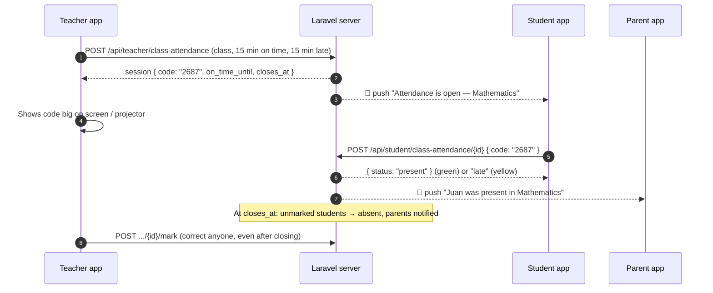

| Time | Result | Colour |
|---|---|---|
| `opened_at` → `on_time_until` | **present** | green `#16A34A` |
| `on_time_until` → `closes_at` | **late** | yellow `#EAB308` (dark text `#3F2D00`) |
| Not marked at `closes_at` | **absent** | red `#DC2626` |

- **Only the code proves the student is in class.** The code is shown only to the teacher; it is never in any student response.
- 5 wrong codes → that student is locked for that session (`429`); the teacher marks them manually.
- Times are ISO-8601 with `+08:00`. Every screen gets `server_time` — compute countdowns with
  `skew = DateTime.now() - DateTime.parse(server_time)` so a wrong phone clock does not break them.
- The server decides present/late at the moment of submit. The app's green/yellow button is only a hint.

---

### 2. API rules

`Authorization: Bearer {token}` and `Accept: application/json` on every call.
Errors from these endpoints are `{ "ok": false, "message": "..." }` with status `403` / `422` / `429` — **show `message` as-is**.
Validation errors (missing fields) are the usual `422 { message, errors: { field: [...] } }`.

---

### 3. Teacher

#### 3.1 `GET /api/teacher/class-attendance` — start screen

```json
{
  "classes": [
    { "section_id": 1, "section_name": "CALIMLIM", "grade_level": "7", "subject_id": 3, "subject_name": "Mathematics" }
  ],
  "open": [ { "...": "session object, see 3.2 (with code)" } ],
  "history": [ { "...session object (code null)...", "present_count": 1, "late_count": 2, "absent_count": 0 } ],
  "limits": { "on_time_max": 120, "late_max": 180 }
}
```
- `classes` empty → show "You have no classes yet. The admin assigns your classes in Class Schedules."
- Show each `open` item as a banner ("Mathematics · Grade 7 CALIMLIM is open") → opens the live screen.

#### 3.2 `POST /api/teacher/class-attendance` — start

Body: `{ "section_id": 1, "subject_id": 3, "on_time_minutes": 15, "late_minutes": 15 }`
(`on_time_minutes` 1–120; `late_minutes` 0–180, `0` = no late window). Suggested pickers: 5/10/15/20/30/45/60 and 0/5/10/15/30/45/60.

`201` (verified):
```json
{
  "ok": true,
  "session": {
    "id": 1,
    "section": { "id": 1, "name": "CALIMLIM", "grade_level": "7" },
    "subject": { "id": 3, "name": "Mathematics" },
    "code": "2687",
    "on_time_minutes": 15, "late_minutes": 15,
    "opened_at": "2026-10-22T08:00:00+08:00",
    "on_time_until": "2026-10-22T08:15:00+08:00",
    "closes_at": "2026-10-22T08:30:00+08:00",
    "closed_at": null,
    "is_open": true,
    "phase": "present",
    "server_time": "2026-10-22T08:00:00+08:00"
  }
}
```
Errors: `403` "You do not teach this subject in this section." · `422` "Attendance for this class is already open." → open the existing one from `open`.

#### 3.3 `GET /api/teacher/class-attendance/{id}` — live screen (poll every 5 s while `is_open`)

```json
{
  "session": { "...same as 3.2; code is null once closed; phase: present | late | closed..." },
  "counts": { "present": 1, "late": 1, "absent": 1, "waiting": 0, "total": 3 },
  "students": [
    { "student_id": 108, "name": "Juan Dela Cruz", "lrn": "101953190033", "status": "present",
      "marked_at": "2026-10-22T08:05:00+08:00", "marked_by": "student" }
  ]
}
```
- `status` `null` = not marked yet (grey "Not yet"). `marked_by`: `student` | `teacher` | `system` (system = auto-absent).
- UI: big code (with a "full screen" view for the projector), countdown (green phase then yellow phase),
  counts, list with **P / L / A** buttons per student. When `is_open` turns false, stop polling and refresh once.
- `403` if another teacher's session.

#### 3.4 Actions
| Call | Body | Response |
|---|---|---|
| `POST /api/teacher/class-attendance/{id}/code` | — | `{ "ok": true, "code": "4821" }` (old code stops working) · `422` if closed |
| `POST /api/teacher/class-attendance/{id}/close` | — | `{ "ok": true, "counts": {...} }` — unmarked become absent, parents notified. Ask for confirmation first |
| `POST /api/teacher/class-attendance/{id}/mark` | `{ "student_id": 108, "status": "present" }` (`present`/`late`/`absent`) | `{ "ok": true, "student_id": 108, "status": "present", "marked_at": "..." }` — works **after closing too** (corrections); the parent gets an "Updated:" notification · `422` if the student is not in the class |

---

### 4. Student

#### 4.1 `GET /api/student/class-attendance`

```json
{
  "server_time": "2026-10-22T08:04:10+08:00",
  "open": [
    { "session_id": 1, "subject_name": "Mathematics", "section_name": "CALIMLIM", "teacher_name": "Ms. Gutierrez",
      "on_time_until": "2026-10-22T08:15:00+08:00", "closes_at": "2026-10-22T08:30:00+08:00",
      "phase": "present", "my_status": null, "my_marked_at": null }
  ],
  "history": [
    { "session_id": 1, "subject_name": "Mathematics", "teacher_name": "Ms. Gutierrez", "date": "2026-10-22",
      "status": "absent", "marked_at": null }
  ]
}
```
- One card per `open` item. If `my_status` is set → show the result chip (no input).
- Otherwise: a 4-digit numeric input (`TextInputType.number`, max length 4) + a big button whose colour and text follow the clock:
  before `on_time_until` → green **"I'm present"**; until `closes_at` → yellow **"I'm late"**; after → grey **"Closed"** (disabled) and refresh.
- `history` = last 30 days (newest first). Empty `open` → "No attendance is open right now."

#### 4.2 `POST /api/student/class-attendance/{id}` — `{ "code": "2687" }`

`200` (verified): `{ "ok": true, "status": "present", "marked_at": "2026-10-22T08:05:00+08:00", "message": "You are marked PRESENT at 8:05 AM." }`

| Status | message (examples, verified) | App should |
|---|---|---|
| `422` | `Wrong code. 4 tries left.` | Keep the screen, clear the input, show the message |
| `429` | `Too many wrong codes. Please ask your teacher to mark you.` | Disable the input for this session |
| `422` | `You are already marked present for this class.` | Refresh the list |
| `422` | `Attendance for this class is already closed — you were marked absent.` | Refresh the list |
| `403` | `You are not in this class.` | Refresh the list |

Spaces in the code are ignored by the server. Throttle: 30 requests/min.

---

### 5. Parent

#### 5.1 `GET /api/parent/class-attendance?days=30` (1–180)

Verified:
```json
[
  { "student_id": 108, "student_name": "Juan Dela Cruz",
    "records": [
      { "session_id": 1, "subject_name": "Mathematics", "teacher_name": "Ms. Gutierrez", "date": "2026-10-22",
        "status": "late", "marked_at": "2026-10-22T08:05:00+08:00" }
    ] }
]
```
- Show inside the parent's Attendance screen as a second tab: **"Classes"** (this) next to **"School gate"** (`/api/parent/attendance`).
- `marked_at` is `null` for absent. Summary line per child: "N present · N late · N absent".

---

### 6. Push notifications (same FCM setup as the arrival guide)

All `data` values are **strings**. Both also appear in `GET /api/notifications` (field `type`, full `data`).

**To students when attendance opens** — `data.type = "attendance_open"`:
```json
{
  "notification": { "title": "Attendance is open — Mathematics",
                    "body": "Enter the class code by 8:15 AM to be present (late until 8:30 AM)." },
  "data": { "type": "attendance_open", "session_id": "1", "subject_name": "Mathematics", "section_name": "CALIMLIM",
            "on_time_until": "2026-10-22T08:15:00+08:00", "closes_at": "2026-10-22T08:30:00+08:00" }
}
```
Tap → open the student Class Attendance screen and focus that session's code input.

**To parents for every result** — `data.type = "class_attendance"`:
```json
{
  "notification": { "title": "Juan Dela Cruz was present in Mathematics", "body": "Checked in at 8:05 AM · Oct 22, 2026" },
  "data": { "type": "class_attendance", "student_id": "108", "student_name": "Juan Dela Cruz", "status": "present",
            "subject_name": "Mathematics", "session_id": "1", "marked_at": "2026-10-22T08:05:00+08:00", "updated": "0" }
}
```
- `status`: `present` | `late` | `absent`. For absent, body is `Did not check in · Oct 22, 2026 8:00 AM` and `marked_at` is `""`.
- `updated: "1"` = the teacher corrected an earlier result (title starts with `Updated:`).
- Tap → parent Attendance screen, **Classes** tab, that child.
- Parents who are still `pending` (not verified) get nothing — same rule as gate arrivals.

In-app list (`GET /api/notifications`) shows these with `data` as real JSON types (ints/bools, not strings).

---

### 7. Do NOT

- Do not show or store the code on student devices (it never comes from the API for students anyway).
- Do not decide present/late on the phone — always use the server's response.
- Do not poll the student screen faster than every ~15 s (the countdown is local; refresh on push / on resume / on pull-to-refresh).
- Do not hide server error messages behind generic text.

### 8. Done when

- [ ] Teacher: pick class + windows → start → live screen with big code, full-screen code, countdown, counts, P/L/A, new code, close now
- [ ] Teacher: history list; reopening a closed session shows results and still allows corrections
- [ ] Student: push opens the screen; code input + green/yellow/grey button; all error messages shown as-is; history
- [ ] Parent: "Classes" tab with per-child records; push for every result, "Updated:" corrections
- [ ] Countdowns use `server_time` skew; nothing breaks when lists are empty

---

# Part 7: Face registration QR

## Task for the Flutter app: teacher "Face registration" QR for the kiosk

> Backend: Laravel `dp-lms-web`. Endpoints verified against the running server on 2026-10-28
> (automated test: list → QR → the Raspberry Pi kiosk accepts the QR text → status → a newer QR cancels it).
> Same feature as the website's Teacher › Face Registration page; only advisers can use it.

---

### 0. Before writing code

1. Search the project for the teacher screens, the HTTP client (Dio provider), and `qr_flutter`
   (already used for the student's parent-link QR). Reuse them; do not add a second HTTP client or QR package.
2. Follow the project's existing state management, routing and folder structure.
3. Show the server's `message` text on errors; do not hardcode your own.

### 1. How it works (what the teacher does)

1. Teacher opens **Face registration** (teacher menu) and sees their advisory students with a status.
2. Taps **Show QR** next to a student. The phone shows a big QR, the student's name and a countdown (10 min).
3. The student holds the phone up to the Raspberry Pi kiosk camera. The kiosk takes the face photos.
4. The app sees the status change to `registered` and shows "Face registered" with a check mark.

The QR works once, for that student only. A new QR for the same student cancels the older one.

### 2. Endpoints (Sanctum token, `Accept: application/json`)

#### `GET /api/teacher/face-kiosk`

```json
{
  "students": [
    { "id": 66, "name": "Juan Dela Cruz", "lrn": "123456789012", "grade_level": 7, "section": "Rizal",
      "face_status": "approved", "blocked": false }
  ],
  "registered": 1
}
```

- `face_status`: `"approved"` (registered) · `"pending"` · `"rejected"` · `null` (no face yet)
- `blocked: true` → 3 inappropriate-photo warnings; hide the button and show "Blocked, ask the admin".
- A teacher who is not an adviser gets `"students": []` → empty state:
  "No students to register. Only a section's adviser registers faces here."

#### `POST /api/teacher/face-kiosk/{studentId}` (max 20 per minute)

`200`:
```json
{
  "ok": true,
  "code_id": 15,
  "qr_text": "DPLMS-FACE:Qd3k…40 characters",
  "student": "Juan Dela Cruz",
  "expires_at": "2026-10-28T18:40:00+08:00",
  "server_time": "2026-10-28T18:30:00+08:00"
}
```

- Draw **exactly `qr_text`** with `QrImageView(data: qrText, …)`. White background, at least ~260 px,
  quiet zone on. Do not add or trim anything.
- Countdown: `skew = now - parse(server_time)`; remaining = `parse(expires_at) - (now - skew)`. The phone clock
  may be wrong, so always use the skew.
- Errors: `403 { ok:false, message }` (not this teacher's advisory student), `422 { ok:false, message }`
  (not enrolled in a section, or blocked). Show `message`.

#### `GET /api/teacher/face-kiosk/codes/{code_id}`

`{ "status": "waiting" | "registered" | "expired" | "cancelled" }` (`403 { status: "forbidden" }` if the code is
another teacher's).

- Poll every **3 seconds** while the QR screen is open; **stop** when it closes, when the app goes to the
  background, or on any final status.
- `registered` → replace the QR with a check mark and "Face registered for {student}". When the teacher goes
  back, reload the list so the status shows "Registered".
- `expired` → "This QR expired." + **Make a new QR** button (calls the POST again).
- `cancelled` → "A newer QR replaced this one." + **Make a new QR**.

### 3. Screens

**Face registration (list)**
- Header: "Face registration". One line under it: "Each QR works once, for one student, for 10 minutes."
- Progress line: "{registered} of {students.length} registered".
- One row per student: name, status chip (Registered / Waiting for review / Rejected / No face yet),
  button **Show QR** (or **Register again** when already registered). Buttons at least 44 px tall.
- Pull to refresh.

**QR screen**
- Student name, the QR, countdown "Expires in 9:41", state text under it.
- Raise the screen brightness while this screen is open and restore it on close
  (`screen_brightness` package, only if it is not already in the project; otherwise skip).
- Keep the screen awake while waiting if the project already has `wakelock_plus`; do not add it otherwise.
- Three short steps under the QR: "Hold this screen up to the kiosk camera." /
  "The kiosk greets the student and takes their photos." / "This screen turns green when the face is saved."

### 4. Done means

- [ ] Adviser sees their students; a non-adviser sees the empty state; a student account never sees this menu.
- [ ] Show QR → the Raspberry Pi kiosk accepts the QR from the phone screen and registers the face; the app
      shows "Face registered" without a manual refresh.
- [ ] Expired and replaced QRs show the right message and **Make a new QR** works.
- [ ] Polling stops when leaving the screen (check the server log: no more status calls).
- [ ] No hardcoded error text; the server's `message` is shown.

### 5. Report back

What was implemented, anything in the API that did not match (paste the response), and any extra field the
app needs.

---

# Part 8: Parent arrival notification

## Task for the Flutter app: parent "child arrived at school" notifications

> Backend: Laravel `dp-lms-web`. Every endpoint and JSON sample below was verified against the
> running server on 2026-10-21 (end-to-end test: Pi scan → server → parent notification → parent API).
> Read together with `FLUTTER_HANDOFF.md` and `IOT_ARRIVAL_NOTIFICATIONS.md` if you have them.

---

### 0. Before writing code

1. **Search the project first** for `firebase_messaging`, `flutter_local_notifications`, `dp_lms_channel`,
   `fcm-token` and any notification/attendance screens. **Extend what exists — do not create a second
   FCM setup or duplicate services.** Follow the project's existing patterns (state management, HTTP client,
   routing, folder structure).
2. Check `pubspec.yaml` versions. The reference code in §6 is a guide — adapt it to the installed versions
   of `firebase_messaging` and `flutter_local_notifications` (their APIs changed between major versions).
3. `android/app/google-services.json` **must belong to the Firebase project with ID `dp-lms`** — the server
   sends pushes through that project. A different Firebase project = pushes never arrive.

---

### 1. What happens (the whole flow)

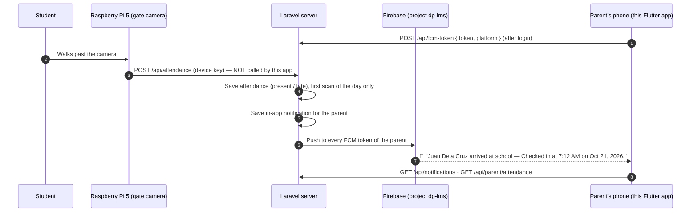

The app's job: **(a)** register the phone's FCM token, **(b)** show the push (also when the app is open),
**(c)** open the right screen when tapped, **(d)** list notifications and attendance history,
**(e)** unregister the token on logout.

---

### 2. API rules (same as the rest of the app)

| Item | Value |
|---|---|
| Base URL | `{APP_URL}/api` |
| Auth | `Authorization: Bearer {token}` (Sanctum, from login / parent activate) |
| Always send | `Accept: application/json` |
| Parent login | `POST /api/login` with key **`email`** — accepts email **or** mobile `09XXXXXXXXX` |

Show server `message` / `errors.*` text directly; do not hard-code your own versions.

---

### 3. Endpoints this feature uses

#### 3.1 Register the phone — `POST /api/fcm-token` (any logged-in role)

Request: `{ "token": "<FCM registration token>", "platform": "android" }` (`platform` optional, max 20 chars; use `"android"` / `"ios"`)

Response `200`: `{ "status": "ok" }`

- Call **after every successful login / parent activation / parent recover**, and on **`onTokenRefresh`**.
- Safe to call repeatedly (server upserts by token; if the same phone logs in as another user, the token moves to that user).

#### 3.2 Unregister on logout — `DELETE /api/fcm-token`

Request: `{ "token": "<same FCM token>" }` (JSON body; `?token=...` query string also works)

Response `200`: `{ "status": "ok" }`

- Call this **BEFORE** `POST /api/logout` — logout deletes the Bearer token, after which this call returns `401`.
- If it fails (offline), still log out locally.

#### 3.3 Notification list — `GET /api/notifications`

Returns the latest 50 (read and unread) + unread count. Verified response:

```json
{
  "unread": 1,
  "items": [
    {
      "id": "611fe177-c703-41e1-b1d2-8ff4d9e2f565",
      "type": "arrival",
      "title": "Juan Dela Cruz arrived at school",
      "data": {
        "title": "Juan Dela Cruz arrived at school",
        "subject": "Late",
        "instructor": "Oct 21, 2026 1:10 PM",
        "type": "arrival",
        "url": "/parent/child-records",
        "student_id": 90,
        "student_name": "Juan Dela Cruz",
        "status": "late",
        "attended_at": "2026-10-21T13:10:21+08:00",
        "attendance_id": 4
      },
      "read": false,
      "created_at": "2026-10-21T13:10:21+08:00",
      "time": "0 seconds ago"
    }
  ]
}
```

- `id` is a **UUID string**, not an int.
- For `type == "arrival"` use `data.student_name`, `data.status` (`present` | `late`) and `data.attended_at`
  (ISO-8601 with `+08:00`; format it as local time, e.g. "7:12 AM · Oct 21"). Ignore `subject`/`instructor`/`url`
  (they exist for the web bell).
- Other `type` values may appear (e.g. `module`, `activity`, and **`class_attendance`** / **`attendance_open`** —
  see `FLUTTER_PROMPT_CLASS_ATTENDANCE.md`). Show unknown ones generically with `title`; never crash on an unknown type.

#### 3.4 Mark as read

- `POST /api/notifications/{id}/read` → `{ "ok": true }` (`404` if the id is not the user's)
- `POST /api/notifications/read-all` → `{ "ok": true }`

#### 3.5 Attendance history — `GET /api/parent/attendance?days=30` (parent role only)

`days` = 1–180 (default 30). One entry per linked child. Verified response:

```json
[
  {
    "student_id": 90,
    "student_name": "Juan Dela Cruz",
    "records": [
      { "id": 4, "status": "late", "attended_at": "2026-10-21T13:10:21+08:00", "date": "2026-10-21", "time": "1:10 PM" }
    ]
  }
]
```

- Newest first. A day with no record = the child was not scanned that day (absent or not yet arrived).
- `[]` (empty array) = no linked child yet.

---

### 4. The push message (exactly what FCM delivers)

```json
{
  "notification": {
    "title": "Juan Dela Cruz arrived at school",
    "body": "Checked in at 7:12 AM on Oct 21, 2026."
  },
  "data": {
    "type": "arrival",
    "student_id": "90",
    "student_name": "Juan Dela Cruz",
    "status": "present",
    "attended_at": "2026-10-21T07:12:03+08:00",
    "attendance_id": "4"
  },
  "android": { "priority": "high", "notification": { "channel_id": "dp_lms_channel", "sound": "default" } }
}
```

- For late arrivals the body reads `Checked in at 7:45 AM (late) on Oct 21, 2026.`
- **All `data` values are strings** (FCM rule) — parse `student_id` / `attendance_id` with `int.tryParse`.
- It contains a `notification` block, so when the app is in the **background or closed, Android shows it
  automatically** in channel `dp_lms_channel`. When the app is **open (foreground), FCM does NOT display it —
  the app must show it** with `flutter_local_notifications`.

---

### 5. When the parent gets NO push (not a bug)

| Situation | Reason |
|---|---|
| Second or later scan of the same child on the same day | One arrival per child per day |
| Parent account is `pending` (not yet verified by admin) | Unverified parents get nothing |
| Child not linked to the parent | Nobody to notify |
| Phone never sent its token (`POST /api/fcm-token`) | In-app list still has it (`/api/notifications`), no push |
| Notifications disabled / denied on the phone | Android permission (Android 13+) |
| `google-services.json` from another Firebase project | Server sends through project `dp-lms` |

---

### 6. Implementation steps

1. **Packages:** `firebase_core`, `firebase_messaging`, `flutter_local_notifications` (reuse if already present).
2. **Init (in `main()`):** `await Firebase.initializeApp();` then register a **top-level** background handler
   annotated `@pragma('vm:entry-point')` via `FirebaseMessaging.onBackgroundMessage(...)` (keep it minimal — the
   system already displays the notification; do not show a second one there).
3. **Android channel:** create channel id **`dp_lms_channel`** (name e.g. "DP-LMS", importance **high**) with
   `flutter_local_notifications` at startup. `AndroidManifest.xml`: `<uses-permission android:name="android.permission.POST_NOTIFICATIONS"/>`
   and optionally `<meta-data android:name="com.google.firebase.messaging.default_notification_channel_id" android:value="dp_lms_channel"/>`.
4. **Permission:** call `FirebaseMessaging.instance.requestPermission()` after login (covers Android 13+ and iOS).
   If denied, show a small banner on the parent home: "Turn on notifications to know when your child arrives."
5. **Token:** after login/activation → `getToken()` → `POST /api/fcm-token`. Listen to `onTokenRefresh` and POST
   again while logged in. Keep the last token in memory/secure storage so logout can send it.
6. **Foreground:** `FirebaseMessaging.onMessage.listen` → show it with `flutter_local_notifications` using
   `dp_lms_channel`, put `jsonEncode(message.data)` in the payload, and **refresh** the notification list /
   attendance screen / unread badge if they are visible.
7. **Tap handling** — route `data.type == "arrival"` to the parent **Attendance** screen (select the child with
   `student_id`), anything else to the **Notifications** screen. Handle all three entry points:
   `FirebaseMessaging.instance.getInitialMessage()` (app was closed), `FirebaseMessaging.onMessageOpenedApp`
   (app in background), and the local-notification tap callback (foreground notification, read the payload).
   On open, call `POST /api/notifications/read-all` or mark the specific one read when the list loads.
8. **Screens (parent):**
   - **Notifications**: `GET /api/notifications`, unread badge = `unread`, pull-to-refresh, tap → mark read.
     Arrival tile: child name, "On time" (green) / "Late" (amber), local time from `attended_at`.
   - **Attendance**: `GET /api/parent/attendance?days=30`, one section per child, rows `date` + `time` + status chip,
     pull-to-refresh; empty state "No arrivals recorded in the last 30 days."
9. **Logout:** `DELETE /api/fcm-token` (with the token) → then `POST /api/logout` → clear local data.

Reference (adapt to installed versions):

```dart
const dpChannel = AndroidNotificationChannel(
  'dp_lms_channel', 'DP-LMS',
  description: 'School notifications (arrivals, activities)',
  importance: Importance.high,
);

@pragma('vm:entry-point')
Future<void> firebaseBackgroundHandler(RemoteMessage message) async {
  await Firebase.initializeApp(); // nothing else — Android already shows the notification
}

// DateFormat comes from package:intl (add it if the project doesn't have it yet)
String arrivalSubtitle(Map<String, dynamic> data) {
  final at = DateTime.tryParse(data['attended_at']?.toString() ?? '')?.toLocal();
  final status = data['status'] == 'late' ? 'Late' : 'On time';
  return at == null ? status : '$status · ${DateFormat('h:mm a · MMM d').format(at)}';
}
```

---

### 7. Do NOT

- Do **not** call `POST /api/attendance` or `GET /api/faces/approved` from the app — those are for the Raspberry Pi
  and need the device key. **Never put `X-Device-Key` / `ATTENDANCE_DEVICE_KEY` in the app.**
- Do not rename JSON keys, and do not assume `data` values in the push are ints.
- Do not show a second notification from the background handler (duplicate notifications).
- Do not block login if token registration fails — log it and continue.

---

### 8. How to test (with the backend team)

1. Parent account must be **approved** and **linked** to the student; log in on a real Android phone; allow notifications.
2. Confirm the token reached the server (backend: `fcm_tokens` table has a row for the parent).
3. Simulate the Raspberry Pi (backend side, the key stays on the server/Pi):
   ```bash
   curl -X POST "{APP_URL}/api/attendance" \
     -H "Accept: application/json" \
     -H "X-Device-Key: <ATTENDANCE_DEVICE_KEY>" \
     -d "student_id=<student's email>"
   ```
   Expected: `{"success":true,"message":"Attendance recorded!",...}` and the phone shows the notification
   in all three states: app open, in background, closed.
4. Only the **first** scan per child per day notifies. To repeat on a local server:
   `php artisan tinker --execute="App\Models\Attendance::whereDate('attended_at', today())->delete();"`

### 9. Done when

- [ ] Token is registered after login and on refresh; removed on logout (before `/api/logout`)
- [ ] Push shows when the app is closed, in background, **and** open
- [ ] Tapping an arrival opens the Attendance screen for that child
- [ ] Notifications screen: list, unread badge, mark read, pull-to-refresh, unknown types don't crash
- [ ] Attendance screen: per child, newest first, empty state
- [ ] No crash when `items` / `records` are empty or the parent has no linked child
- [ ] No device key anywhere in the app

---

# Part 9: Backend handoff

## DP-LMS — Backend changes para sa Flutter app

Para sa: developer (o Claude Code session) na gumagawa sa Flutter repo (`dp_lms`).
Backend repo: `dp-lms-web` (Laravel 12), branch `feature/parent-link`.

> Ang flowcharts ay Mermaid — nire-render ng GitHub at ng VS Code
> (extension: "Markdown Preview Mermaid Support").
>
> **Kasamang dokumento:** `IOT_ARRIVAL_NOTIFICATIONS.md` — Raspberry Pi scan → push sa magulang,
> `GET /api/notifications`, `GET /api/parent/attendance`.
>
> **Lahat ng mensahe ng server ay English na.** Ipakita ang `message` / `errors.*` mula sa server
> nang direkta — huwag mag-hardcode ng sariling bersyon.

---

### 0. Pangkalahatang tuntunin sa API

| Bagay | Halaga |
|---|---|
| Base URL | `{APP_URL}/api` |
| Auth | `Authorization: Bearer {token}` (Laravel Sanctum) |
| **Laging ipadala** | `Accept: application/json` — kung wala, redirect (302) ang validation error imbes na JSON |
| Password rule (lahat) | min 8, may malaki at maliit na letra, numero, at simbolo |
| JSON key ng login | `email` pa rin (**huwag palitan**) — tumatanggap ng email, LRN, o mobile |

#### Hugis ng error

| Status | Kailan | Body |
|---|---|---|
| `422` | Validation | `{ "message": "...", "errors": { "field": ["mensahe"] } }` |
| `401` | Walang/expired na token, o maling login | `{ "message": "..." }` |
| `403` | **BAGO (2026-10-27):** na-reject o na-ban ang account habang naka-login — sa **kahit anong** protected endpoint. Binubura na ng server ang token → burahin din sa app at bumalik sa login | `{ "message": "Your account is not active. Please contact the school." }` |
| `403` / `404` / `422` | Bawal ang aksyon (hal. sarado na ang quiz) | `{ "ok": false, "message": "..." }` |
| `410` | Tinanggal na endpoint (`/register`) | `{ "message": "..." }` |
| `429` | Rate limit | `{ "message": "Too Many Attempts." }` |

---

### 1. Buod ng mga pagbabago

#### ⚠️ Breaking (kailangang baguhin ang app)

| Endpoint | Dati | Ngayon |
|---|---|---|
| `POST /api/register` | Gumagawa ng account | **`410 Gone`** — gamitin ang `/api/activate` (estudyante) o `/api/parent/activate` (magulang) |
| `POST /api/student/enroll` | Halos walang validation sa pangalan ng magulang | Kaparehong rules ng web (tingnan §4.4). `422` kapag enrolled na sa school year na ito |
| `POST /api/teacher/submissions/{id}/grade` | `remarks` = feedback (pinapalitan ang sagot ng estudyante) | **`feedback`** na ang field. Tinatanggap pa ang `remarks` bilang fallback, pero sa `feedback` column na nase-save |
| `POST /api/teacher/grades` | Puwedeng i-grade ang kahit sinong user | `403` kapag hindi itinuturo ng teacher ang subject sa section ng estudyante |
| `POST /api/teacher/announcements` | Kahit anong `section_id` | Sariling section lang, kung hindi `422 errors.section_id` |
| `POST /api/student/materials/{id}/*` | Kahit anong material | `404` kapag hindi published o hindi sa section ng estudyante |

#### ✅ Bago

| Endpoint | Gamit |
|---|---|
| `POST /api/activate` · `/activate/verify` · `/activate/resend` | Unang beses na pag-activate ng student account |
| `POST /api/forgot-password` · `/forgot-password/reset` | Tunay na forgot password (dati stub — walang ipinapadala) |
| `POST /api/parent/activate` · `/api/parent/recover` | Parent account gamit ang code mula sa anak |
| `POST /api/student/parent-link` | Estudyante: gumawa ng code/QR para sa magulang |
| `POST /api/messages/typing/{user}` · `PATCH /api/messages/{id}` · `DELETE /api/messages/{id}` | Typing, edit, unsend — **dati may method pero walang route (404)** |
| `GET /api/notifications` · `POST /api/notifications/{id}/read` · `/read-all` | Notification inbox (lahat ng role) — tingnan ang IoT doc |
| `GET /api/parent/attendance?days=30` | Arrival history ng anak (Raspberry Pi scans) |

#### ➕ Additive (hindi masisira ang dating code)

- `GET /api/student/assignments/{id}` → `submission.feedback`
- `GET /api/teacher/assignments/{id}` → `submissions[].feedback`
- `GET /api/student/grades` → `school_year`
- Announcements (student/parent) — school-wide + para sa sariling section lang
- Teacher dashboard / students / attendance — kasama na ang **advisory** class

---

### 2. Student activation (pamalit sa register)

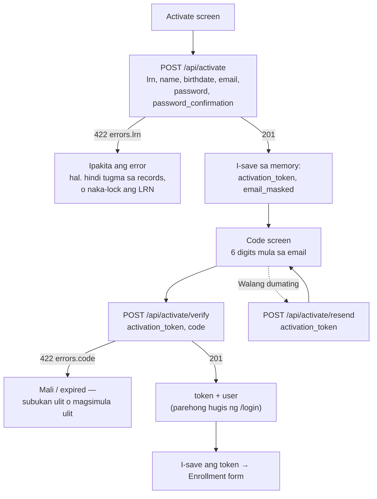

#### `POST /api/activate` (throttle 20/min)

```json
{
  "lrn": "101953190033",
  "name": "Ajhay Esmeralda Agoc",
  "birthdate": "2013-03-15",
  "email": "ajhay@gmail.com",
  "password": "Secret#123",
  "password_confirmation": "Secret#123"
}
```

| Response | Body |
|---|---|
| `201` | `{ "message", "activation_token": "48 chars", "email_masked": "aj•••@gmail.com", "expires_at": "ISO-8601" }` |
| `422 errors.lrn` | Hindi tugma ang LRN at pangalan **(iisang mensahe para sa maling LRN at maling pangalan — sinadya)**, naka-lock (5 mali/oras, 10/araw), o may account na |
| `422 errors.email` | Gamit na ang email, o hindi maipadala ang code |

- `name` — dapat tugma sa masterlist (hindi mahalaga ang ayos, laki ng letra, o accent: "Peña" = "Pena").
- `birthdate` — `YYYY-MM-DD`, hindi bababa sa 8 taong gulang.
- **Walang account na nagagawa sa hakbang na ito.** Ang token ay valid nang 10 minuto.

#### `POST /api/activate/verify` (throttle 20/min)

`{ "activation_token": "...", "code": "123456" }`

| Response | Body |
|---|---|
| `201` | `{ "message": "Account activated.", "token", "user": { id, name, email, role, grade_level, status } }` |
| `422 errors.code` | Mali (5 subok), expired, o may nauna nang nag-activate |

#### `POST /api/activate/resend` (throttle 5/10 min)

`{ "activation_token": "..." }` → `200 { "message" }`. Hanggang 3 beses; bagong code at bagong 10 minuto.

> Pagkatapos mag-activate, **walang section** pa ang estudyante → walang subjects/modules/grades
> hanggang ma-approve ng adviser ang enrollment form. Ipakita ang enrollment form agad.

---

### 3. Login, forgot password

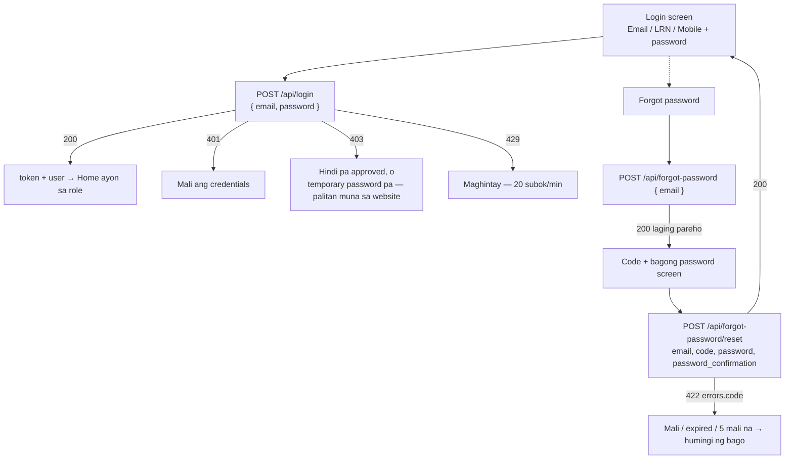

#### `POST /api/login` (throttle 20/min)

`{ "email": "<email | 12-digit LRN | 09XXXXXXXXX>", "password": "..." }`

- `200` → `{ "token", "user": { id, name, email, role, grade_level, status } }`
- Mobile: tinatanggap ang `+63 917 123 4567`, `09171234567`, atbp. Ang **12-digit na purong numero ay LRN**.
- **May email code na** ang mobile login, kapareho ng website. Sundin ang `FLUTTER_PROMPT_LOGIN_OTP.md`.
- `403 { "message": "Account not yet approved." }` — pending/rejected na account.
- **BAGO (2026-10-21):** `403 { "message": "Please log in on the website first and set a new password." }` —
  lumang teacher account na may *temporary password* pa. Ipakita ang `message` as-is (walang token).
  Ang mga bagong teacher ay nag-a-activate gamit ang **activation link** sa browser (sariling email + password),
  tapos saka mag-login sa app — walang pagbabago sa login screen.

#### `POST /api/forgot-password` (throttle 10/min)

`{ "email": "..." }` → `200 { "message", "expires_minutes": 10 }` — **pareho ang sagot may account man o wala**. `429` kapag lampas sa 3 kada 5 minuto para sa iisang email.

#### `POST /api/forgot-password/reset` (throttle 20/min)

`{ "email", "code", "password", "password_confirmation" }` → `200 { "message" }`.
Pagkatapos: **lahat ng dating token ng user ay buburahin** (mala-logout sa ibang device).

---

### 4. Estudyante

#### 4.1 Magulang (parent link)

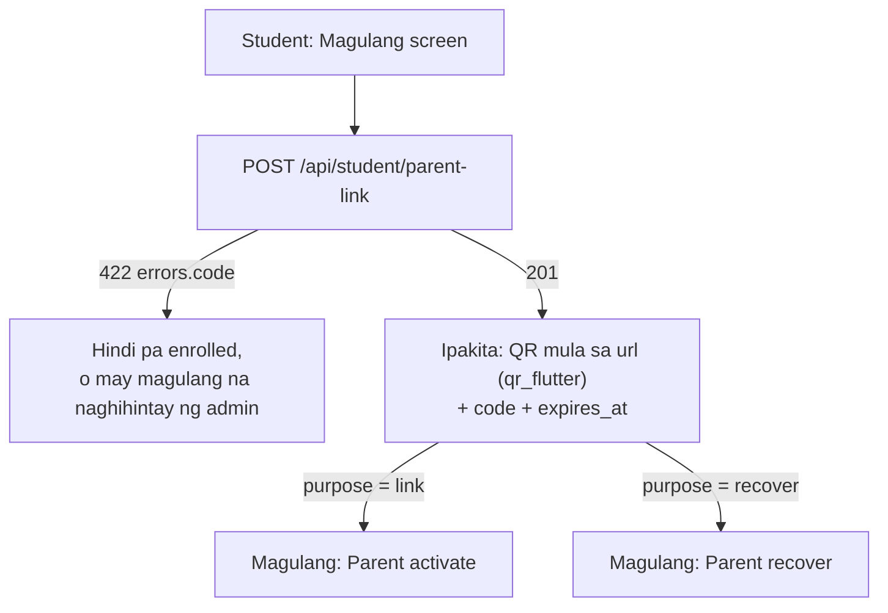

`POST /api/student/parent-link` (throttle 10/10 min) →

```json
{
  "code": "M4MD-589A",
  "purpose": "link",
  "expires_at": "2026-10-21T08:00:00+08:00",
  "url": "https://.../parent/activate?code=M4MD-589A"
}
```

- `purpose: "link"` kapag wala pang magulang; `"recover"` kapag mayroon na (para sa bagong phone / nakalimutang password).
- Valid nang **24 oras, isang beses lang**. Ang bagong code ay pumapatay sa luma.
- Ang `url` ay web page din — puwedeng i-scan ng kahit anong camera app.

#### 4.2 Quizzes / assignments

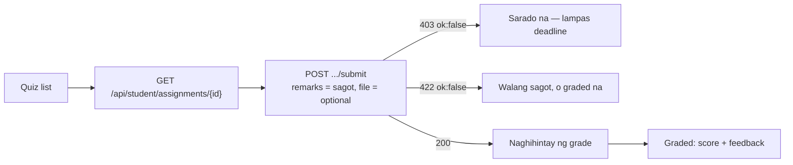

`GET /api/student/assignments/{id}` → `submission`: `{ id, file_url, remarks (sagot mo), feedback (komento ng teacher — BAGO), score, status, submitted_at }`

#### 4.3 Materials

`/api/student/materials/{id}` (detail/view/like/comments) — `404` na kapag ang material ay hindi published o hindi itinuturo sa section ng estudyante. Gamitin lang ang mga ID mula sa `GET /api/student/modules`.

#### 4.4 Enrollment — `POST /api/student/enroll`

| Field | Rule |
|---|---|
| `student_type` | required: `new` / `old` / `transfer` |
| `full_name` | required, letra lang (pinapayagan ang ñ, tuldok, gitling, apostrophe) |
| `age` | required, 10–25 |
| `birthdate` | required, `YYYY-MM-DD`, bago ngayong araw |
| `gender` | required: `Male` / `Female` |
| `address` | required, max 500 |
| `mother_name`, `father_name`, `guardian_name` | optional, letra lang — **ito ang ikukumpara kapag nag-link ang magulang** |
| `guardian_contact` | optional, numero/`+`/`-`/espasyo, max 20 |
| `last_school`, `last_grade_completed` | optional (dati hindi nase-save sa API — ngayon oo) |
| `general_average` | **BAGO (2026-10-21)** — optional, number `60`–`100` (hal. `88.5`). General average noong nakaraang school year (Form 138). Ginagamit ng adviser/admin para balanse ang sections (heterogeneous). Label sa app: "General Average last school year (optional)" |

`422 errors.student_type` = "already enrolled for this school year".

#### 4.5 Announcements, grades

- `GET /api/student/announcements` at `dashboard.announcements` — school-wide + para sa section mo lang.
- `GET /api/student/grades` — may `school_year` na bawat row.

---

### 5. Magulang

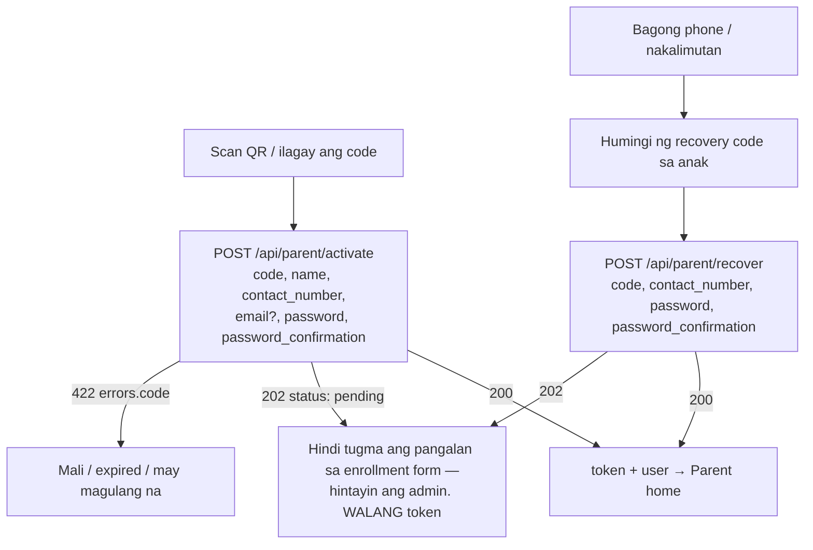

#### `POST /api/parent/activate` (throttle 30/min)

```json
{
  "code": "M4MD-589A",
  "name": "Maria Santos Dela Cruz",
  "contact_number": "09171234567",
  "email": null,
  "password": "Secret#123",
  "password_confirmation": "Secret#123"
}
```

| Response | Body |
|---|---|
| `200` | `{ "message": "Account created.", "token", "user" }` — tugma ang pangalan sa mother/father/guardian ng anak |
| `202` | `{ "message", "status": "pending" }` — hindi tugma; **walang token**, hintayin ang admin |
| `422` | `errors.code` (mali/expired/may magulang na), `errors.contact_number` (format o gamit na), `errors.email`, `errors.name` (dapat buong pangalan) |

- `code`: tinatanggap ang `M4MD-589A`, `m4md589a`, atbp.
- `contact_number`: `09XXXXXXXXX` o `+63…` (ginagawang `09…` ng server).
- `email` optional. Kung wala, ang **mobile number** ang pang-login.

#### `POST /api/parent/recover` (throttle 30/min)

`{ "code", "contact_number", "password", "password_confirmation" }` → `200 { "message": "Password updated.", "token", "user" }` o `202` (pending).
Pinapatay ang lahat ng dating token ng magulang.

---

### 6. Teacher

#### 6.1 Pag-grade ng submission

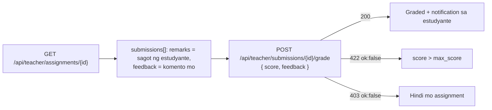

#### 6.2 Grades — `POST /api/teacher/grades`

Body (hindi nagbago): `{ student_id, subject_id, quarter: Q1–Q4, written_works?, performance_tasks?, quarterly_assessment? }`
- `403 { message }` — hindi itinuturo ng teacher ang subject sa **section ng estudyante**.
- `422 { message }` — hindi estudyante ang `student_id`.
- Isang grade kada estudyante × subject × quarter × **school year** (hindi na napapalitan ang grade ng nakaraang taon).

#### 6.3 Announcements — `POST /api/teacher/announcements`

`{ title, body (max 20000), audience: all|students|parents, section_id? }` — ang `section_id` ay dapat isa sa sariling section (subject o advisory).

#### 6.4 Students, dashboard, attendance

Kasama na ang mga estudyante ng **advisory section** (dati subject sections lang).

---

### 7. Chat (student ↔ teacher)

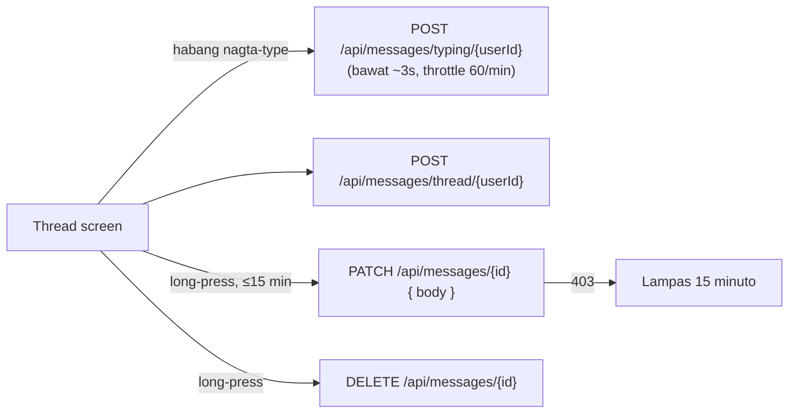

| Endpoint | Body | Response |
|---|---|---|
| `POST /api/messages/typing/{userId}` | — | `{ ok: true }` |
| `PATCH /api/messages/{id}` | `{ body }` (max 2000) | `{ ok: true, message: { id, body, edited: true } }` · `403` kapag lampas 15 min |
| `DELETE /api/messages/{id}` | — | `{ ok: true }` (sariling message lang) |

`GET /api/messages/thread/{userId}` ay may `peer_typing`, at bawat message ay may `edited` at `can_edit`.

#### Bad-word filter (bago)

Ang **send**, **edit** ng chat at ang **material comment** ay tinatanggihan kapag may mura:
`422 { "message": "...", "errors": { "body": ["Please avoid inappropriate language."] } }`

- Buong salita ang tsine-check — hindi nahaharang ang "gagawin", "computation", "leche flan".
- Nahuhuli: `g@g0`, `p.u.t.a`, `p u t a`, `putaaa`, `gagong`, `fucking`.
- Ipakita ang `errors.body[0]` sa ilalim ng input; **huwag burahin ang tinype** para maitama ng user.

---

### 8. IoT (Raspberry Pi / ESP32) — para sa `config.py` ng Pi

| Endpoint | Pagbabago |
|---|---|
| `POST /api/attendance` | Isang record lang kada estudyante kada araw. Ang pangalawang scan ay `200 { success: true, message: "Attendance already recorded today.", status }`. May `status` na rin (`present`/`late`) ang response |
| `GET /api/attendance` | **Kailangan na ng `X-Device-Key`** at piling field na lang ang ibinabalik (dati: buong user record, walang auth) |
| `GET /api/faces/approved` | Walang pagbabago |

Lahat ay may `X-Device-Key` (dapat kapareho ng `ATTENDANCE_DEVICE_KEY` sa server), throttle 120/min.

---

### 8.1 Face registration — KIOSK ONLY na (2026-10-21)

Hindi na nagre-register ng mukha ang estudyante sa phone. Ang **adviser** ang nagpapakita ng one-time QR,
at sa **Raspberry Pi kiosk** kinukunan ang mukha (tingnan `RASPBERRY_PI_FACE_KIOSK.md`). Dahilan: mas secure
(nakikita ng adviser kung sino talaga ang nasa camera — walang ibang mukha sa account ng iba) at walang
admin review queue.

| Endpoint | Ngayon |
|---|---|
| `GET /api/student/face` | Gumagana pa. Bagong fields: `self_upload` (`false`) at `how_to` (text na ipapakita) |
| `POST /api/student/face` | **`403 { ok:false, message: "Face registration is done at the school kiosk. Ask your adviser to register your face." }`** habang `self_upload` = false |

Sa app: kapag `self_upload` = `false`, **itago ang camera/upload screen** at ipakita na lang ang status:
`status = approved` → "Your face is registered ✓"; kung hindi → ipakita ang `how_to`. Ang server
setting ay `FACE_SELF_UPLOAD` (default `false`) — kapag ginawang `true`, babalik ang dating upload flow.

### 9. Checklist para sa Flutter

- [ ] Ipadala ang `Accept: application/json` sa **lahat** ng request
- [ ] Palitan ang **Register** screen → **Activate** (2 hakbang: form → 6-digit code). `activation_token` sa memory lang
- [ ] Login label: "Email, LRN, o Mobile number" (key ay `email` pa rin)
- [ ] **Forgot password**: 2 screen (email → code + bagong password)
- [ ] Student **"Magulang"** screen: `POST /api/student/parent-link`, QR mula sa `url` (`qr_flutter`), code + countdown
- [ ] Parent **activate** screen: scan QR (`mobile_scanner`) → kunin ang `code` query param, o i-type ang code
- [ ] Parent **recover** screen
- [ ] Hawakan ang `202 { status: "pending" }` sa parent activate/recover (walang token)
- [ ] Chat: ikabit ang typing / edit / unsend sa mga bagong route
- [ ] Chat + comments: ipakita ang `422 errors.body` (bad-word filter) nang hindi binubura ang tinype
- [ ] Quiz detail (student): ipakita ang `feedback`; teacher grading: ipadala ang `feedback`
- [ ] Enrollment form: client-side validation na tugma sa §4.4
- [ ] Teacher announcement form: piliin lang ang sariling sections

---

# Part 10: Reference: Raspberry Pi to parent

## Arrival notifications — Raspberry Pi 5 → Server → Parent's Flutter app

Para sa: Flutter developer (o Claude Code session) ng `dp_lms` app, at sa gumagawa ng Raspberry Pi script.
Backend: `dp-lms-web` (Laravel). Basahin kasama ng `FLUTTER_HANDOFF.md`.

> **Pagre-register ng mukha:** sa Raspberry Pi kiosk na gamit ang one-time QR mula sa adviser/admin —
> tingnan ang `RASPBERRY_PI_FACE_KIOSK.md` at `docs/raspberry-pi/face_kiosk.py`. Ang mga mukhang na-register
> doon ay **approved agad** at lumalabas sa `GET /api/faces/approved`.

> **Ano ang nangyayari:** tumapat ang estudyante sa camera ng Raspberry Pi 5 sa gate →
> nakilala ang mukha → nag-POST ang Pi sa server → na-save ang attendance →
> **agad na push notification sa phone ng magulang**: *"Juan Dela Cruz arrived at school —
> Checked in at 7:12 AM on Oct 21, 2026."*

---

### 1. Buong daloy

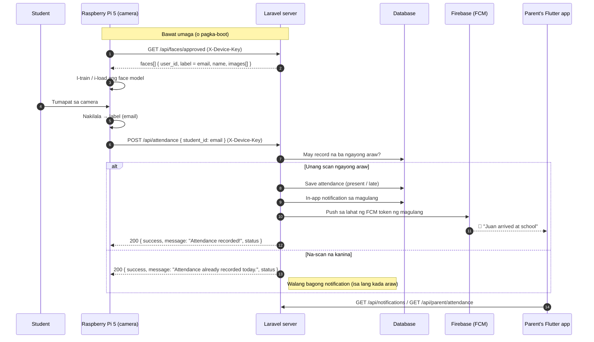

#### Kailan **walang** notification na ipapadala

| Sitwasyon | Bakit |
|---|---|
| Pangalawa o higit pang scan sa parehong araw | Isa lang kada estudyante kada araw (dedupe) |
| Walang naka-link na magulang ang estudyante | Walang padadalhan |
| Ang magulang ay `pending` pa (hindi pa na-verify ng admin) | Hindi pa puwedeng makita ang records ng anak |
| Hindi nakilala ang `student_id` (walang tugmang estudyante) | Naka-save ang attendance pero walang `user_id` |
| Walang naka-register na FCM token ang magulang | In-app notification lang (`/api/notifications`) — walang push |

---

### 2. Raspberry Pi — API contract

Lahat ng request: header **`X-Device-Key: <ATTENDANCE_DEVICE_KEY>`** (parehong value sa server `.env`/Railway variables at sa `config.py` ng Pi). Throttle: 120 request/min kada IP.

> **(2026-10-21) Fail-closed na:** kapag walang `ATTENDANCE_DEVICE_KEY` sa server, bukas lang ito kapag
> `APP_ENV=local` (XAMPP). Sa production (Railway, `APP_ENV=production`) → **`401 Unauthorized device`**
> hangga't hindi naitatakda ang key. Dati bukas sa lahat — kahit sino ay makakapag-post ng pekeng arrival.

#### `GET /api/faces/approved`

```json
{
  "faces": [
    {
      "user_id": 12,
      "label": "juan@gmail.com",
      "name": "Juan Dela Cruz",
      "reviewed_at": "2026-10-20T09:15:00+08:00",
      "images": ["https://.../api/faces/12/img_01.jpg", "..."]
    }
  ]
}
```
Gamitin ang **`user_id`** bilang ID ng mukha sa model (`label`/email ay tinatanggap pa rin).

**(2026-10-28) Private na ang face photos.** Wala na sa `/storage/faces/...`. Bawat `images[]` URL ay
kailangan ding may **`X-Device-Key`** header (`GET /api/faces/{user_id}/img_01.jpg` → `200 image/jpeg`,
`Cache-Control: no-store`). Walang key → `401`; hindi approved ang mukha o wala ang file → `404`.

#### `POST /api/attendance`

```json
{ "student_id": "juan@gmail.com", "student_name": "Juan Dela Cruz", "section_id": null }
```

| Field | Rule |
|---|---|
| `student_id` | required — ang `label` (email) mula sa `/api/faces/approved`; tinatanggap din ang numeric user ID |
| `student_name` | optional |
| `section_id` | optional; dapat umiiral na section ID — **mas mabuting huwag ipadala** (kinukuha ng server sa account) |
| `score` | optional, `0`–`1` — similarity ng match (para sa recognition log) |
| `device` | optional, hanggang 64 characters (hal. `gate-1`) |
| `scanned_at` | optional, ISO 8601 — kailan talaga nakita ang mukha. Para sa scan na na-queue habang offline: ito ang ginagamit sa oras at present/late. Hanggang **2 araw** ang tanda; mas luma o nasa future → `422` |

**Recognition log (2026-10-28):** bawat `POST /api/attendance` ay naitatala sa `gate_scans`
(`recognized`, o `repeat` kapag na-scan na ngayong araw). Ang mukhang hindi nakilala ay
`POST /api/gate/unknown { score?, device?, scanned_at? }` → `200 { "success": true }` — score lang,
walang litrato. Ma-download ng admin bilang CSV: Reports → Downloads → **Recognition log**.

| Response | Body |
|---|---|
| `200` (bagong record) | `{ "success": true, "message": "Attendance recorded!", "student": "Juan Dela Cruz", "status": "present" \| "late" }` |
| `200` (na-scan na) | `{ "success": true, "message": "Attendance already recorded today.", "student": "...", "status": "..." }` |
| `401` | `{ "success": false, "message": "Unauthorized device." }` — maling o walang `X-Device-Key` |
| `422` | Validation (hal. walang `student_id`, o maling `section_id`) |

- **Late:** kapag ang scan ay lampas sa `ATTENDANCE_LATE_AFTER` (default `07:30`, Asia/Manila).
- Ang Pi ay puwedeng mag-retry nang ligtas — hindi magdodoble ang record o ang notification.

#### Halimbawa (Python sa Pi)

```python
import requests

API = "https://<your-domain>/api/attendance"
HEADERS = {"X-Device-Key": DEVICE_KEY, "Accept": "application/json"}

def report_arrival(label: str, name: str | None = None) -> None:
    try:
        r = requests.post(API, json={"student_id": label, "student_name": name},
                          headers=HEADERS, timeout=5)
        data = r.json()
        print(r.status_code, data.get("message"), data.get("status"))
    except requests.RequestException as e:
        # I-queue at subukan ulit mamaya (ligtas — may dedupe ang server)
        print("network error:", e)
```

> Para iwas-spam sa camera mismo: huwag i-POST ang parehong `label` nang paulit-ulit
> sa loob ng ~60 segundo (local cooldown). Ligtas pa rin kung mangyari — dedupe ang server.

---

### 3. Flutter (parent app) — ano ang kailangan

#### 3.1 FCM token — DAPAT naka-register

Pagka-login (at tuwing magbabago ang token):

```dart
final token = await FirebaseMessaging.instance.getToken();
await api.post('/api/fcm-token', {'token': token, 'platform': Platform.isIOS ? 'ios' : 'android'});

FirebaseMessaging.instance.onTokenRefresh.listen((t) =>
    api.post('/api/fcm-token', {'token': t, 'platform': Platform.isIOS ? 'ios' : 'android'}));
```

Pag-logout: `DELETE /api/fcm-token { token }` — para hindi na makatanggap ang lumang phone.

#### 3.2 Push payload (FCM v1)

```json
{
  "notification": {
    "title": "Juan Dela Cruz arrived at school",
    "body": "Checked in at 7:12 AM on Oct 21, 2026."
  },
  "data": {
    "type": "arrival",
    "student_id": "12",
    "student_name": "Juan Dela Cruz",
    "status": "present",
    "attended_at": "2026-10-21T07:12:44+08:00",
    "attendance_id": "345"
  },
  "android": { "priority": "high", "notification": { "channel_id": "dp_lms_channel" } }
}
```

- **Lahat ng `data` value ay string** (FCM rule) — i-parse ang `student_id`/`attendance_id` gamit ang `int.parse`.
- `status`: `present` o `late` — puwedeng iba ang kulay/icon sa UI.
- Android channel: **`dp_lms_channel`** (kapareho ng ibang notification ng app; importance high).

#### 3.3 Pag-handle sa app

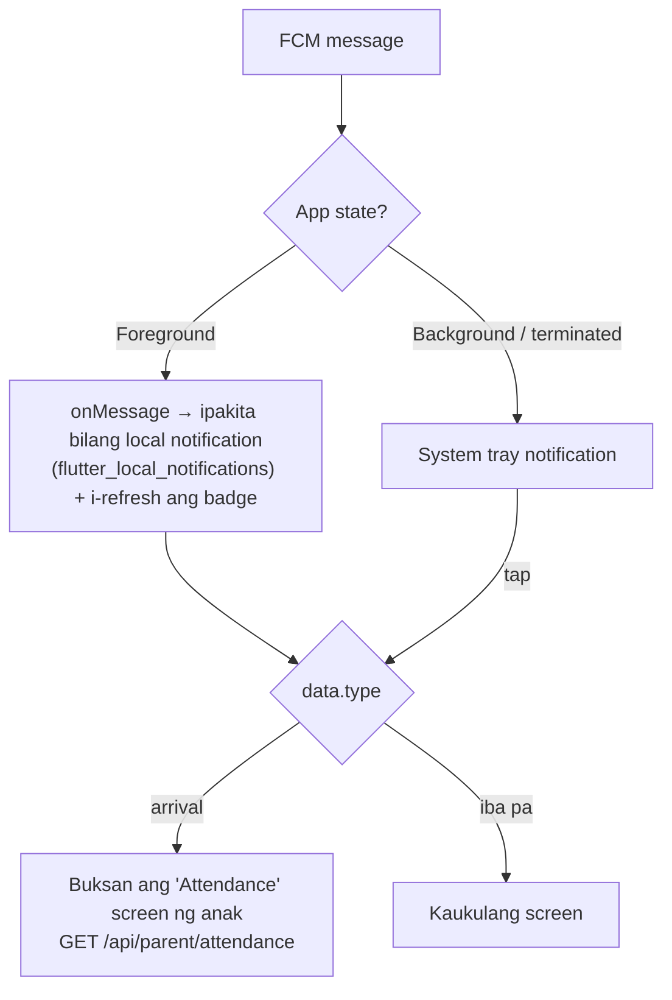

```dart
FirebaseMessaging.onMessage.listen((m) {
  if (m.data['type'] == 'arrival') {
    showLocalNotification(m.notification?.title, m.notification?.body, payload: m.data);
    ref.invalidate(notificationsProvider);   // Riverpod: i-refresh ang listahan/badge
  }
});

FirebaseMessaging.onMessageOpenedApp.listen((m) => routeFromPush(m.data));
final initial = await FirebaseMessaging.instance.getInitialMessage();
if (initial != null) routeFromPush(initial.data);

void routeFromPush(Map<String, dynamic> d) {
  if (d['type'] == 'arrival') {
    router.push('/parent/attendance?student=${d['student_id']}');
  }
}
```

#### 3.4 Mga bagong endpoint (Sanctum token)

##### `GET /api/notifications` — notification inbox (lahat ng role)

```json
{
  "unread": 2,
  "items": [
    {
      "id": "9b1c…uuid",
      "type": "arrival",
      "title": "Juan Dela Cruz arrived at school",
      "data": {
        "type": "arrival",
        "student_id": 12,
        "student_name": "Juan Dela Cruz",
        "status": "present",
        "attended_at": "2026-10-21T07:12:44+08:00",
        "attendance_id": 345,
        "subject": "On time",
        "instructor": "Oct 21, 2026 7:12 AM",
        "url": "/parent/child-records"
      },
      "read": false,
      "created_at": "2026-10-21T07:12:45+08:00",
      "time": "2 minutes ago"
    }
  ]
}
```

- `POST /api/notifications/{id}/read` → `{ ok: true }`
- `POST /api/notifications/read-all` → `{ ok: true }`

##### `GET /api/parent/attendance?days=30` — arrival history (1–180 araw)

```json
[
  {
    "student_id": 12,
    "student_name": "Juan Dela Cruz",
    "records": [
      { "id": 345, "status": "present", "attended_at": "2026-10-21T07:12:44+08:00", "date": "2026-10-21", "time": "7:12 AM" },
      { "id": 331, "status": "late",    "attended_at": "2026-10-20T07:41:02+08:00", "date": "2026-10-20", "time": "7:41 AM" }
    ]
  }
]
```

Walang record sa isang araw ng klase = hindi pa nag-scan (posibleng absent o hindi pa dumarating).

#### 3.5 Mga screen na gagawin

- [ ] **Notifications inbox** (`GET /api/notifications`) — badge = `unread`
- [ ] **Child attendance** (`GET /api/parent/attendance`) — listahan kada araw, may kulay ang `late`
- [ ] Parent home: card na "Arrived today at 7:12 AM" (kunin ang unang record ngayong araw)
- [ ] FCM: register token pagka-login, unregister pagka-logout, `onMessage` / `onMessageOpenedApp` / `getInitialMessage`
- [ ] Android: tiyaking umiiral ang channel `dp_lms_channel` (importance high) at may `POST_NOTIFICATIONS` permission (Android 13+)

---

### 4. Pagsubok (end-to-end)

1. Server: itakda ang `ATTENDANCE_DEVICE_KEY` sa `.env` (local) o Railway variables.
2. Siguraduhing may **naka-link at approved na magulang** ang estudyante, at naka-login ang magulang sa app (may FCM token).
3. I-simulate ang Pi scan:

```bash
curl -X POST https://<your-domain>/api/attendance \
  -H "X-Device-Key: <key>" -H "Accept: application/json" -H "Content-Type: application/json" \
  -d '{"student_id":"juan@gmail.com"}'
```

4. Inaasahan: `200 "Attendance recorded!"` → push sa phone ng magulang sa loob ng ilang segundo.
5. Ulitin ang curl → `"Attendance already recorded today."` at **walang** pangalawang push.

> Firebase credentials ng server: `FIREBASE_CREDENTIALS_BASE64` (Railway) o
> `storage/app/firebase/firebase-service-account.json` (local). Kung wala, in-app notification lang ang gagana.
