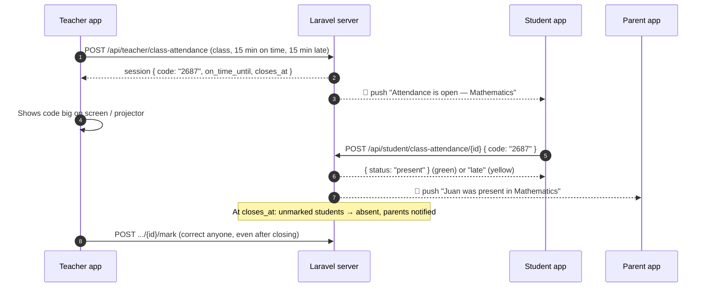

# Task for the Flutter app: class attendance (teacher opens it, students enter the code)

> Paste this whole file into the Claude Code session of the Flutter project (`dp_lms`).
> Backend: Laravel `dp-lms-web`. All endpoints below were verified end-to-end on 2026-10-21
> (34 automated checks: open → notify → code → present/late → auto-absent → teacher correction → parent).
> Read `FLUTTER_PROMPT_PARENT_ARRIVAL.md` first — it sets up FCM (token register, channel `dp_lms_channel`,
> foreground display, tap handling). This feature reuses that setup.

---

## 0. Before writing code

1. Search the project for existing attendance screens and the FCM setup. Extend them; do not duplicate.
2. The **teacher's old "Attendance" screen** (if it calls `GET /api/teacher/attendance`) showed gate-camera scans.
   Replace it with the new **Class Attendance** screens below. (`GET /api/teacher/attendance` still works but is legacy.)
3. Parents keep the gate-arrival feature (`GET /api/parent/attendance`) — this is an **additional** feature.

---

## 1. How it works



| Time | Result | Colour |
|---|---|---|
| `opened_at` → `on_time_until` | **present** | green `#16A34A` |
| `on_time_until` → `closes_at` | **late** | yellow `#EAB308` (dark text `#3F2D00`) |
| Not marked at `closes_at` | **absent** | red `#DC2626` |

- **Only the code proves the student is in class.** The code is shown only to the teacher; it is never in any student response.
- 5 wrong codes → that student is locked for that session (`429`); the teacher marks them manually.
- Times are ISO-8601 with `+08:00`. Every screen gets `server_time` — compute countdowns with
  `skew = DateTime.now() - DateTime.parse(server_time)` so a wrong phone clock does not break them.
- The server decides present/late at the moment of submit. The app's green/yellow button is only a hint.

---

## 2. API rules

`Authorization: Bearer {token}` and `Accept: application/json` on every call.
Errors from these endpoints are `{ "ok": false, "message": "..." }` with status `403` / `422` / `429` — **show `message` as-is**.
Validation errors (missing fields) are the usual `422 { message, errors: { field: [...] } }`.

---

## 3. Teacher

### 3.1 `GET /api/teacher/class-attendance` — start screen

```json
{
  "classes": [
    { "section_id": 1, "section_name": "CALIMLIM", "grade_level": "7", "subject_id": 3, "subject_name": "Mathematics" }
  ],
  "open": [ { "...": "session object, see 3.2 (with code)" } ],
  "history": [ { "...session object (code null)...", "present_count": 1, "late_count": 2, "absent_count": 0 } ],
  "limits": { "on_time_max": 120, "late_max": 180 }
}
```
- `classes` empty → show "You have no classes yet. The admin assigns your classes in Class Schedules."
- Show each `open` item as a banner ("Mathematics · Grade 7 CALIMLIM is open") → opens the live screen.

### 3.2 `POST /api/teacher/class-attendance` — start

Body: `{ "section_id": 1, "subject_id": 3, "on_time_minutes": 15, "late_minutes": 15 }`
(`on_time_minutes` 1–120; `late_minutes` 0–180, `0` = no late window). Suggested pickers: 5/10/15/20/30/45/60 and 0/5/10/15/30/45/60.

`201` (verified):
```json
{
  "ok": true,
  "session": {
    "id": 1,
    "section": { "id": 1, "name": "CALIMLIM", "grade_level": "7" },
    "subject": { "id": 3, "name": "Mathematics" },
    "code": "2687",
    "on_time_minutes": 15, "late_minutes": 15,
    "opened_at": "2026-10-22T08:00:00+08:00",
    "on_time_until": "2026-10-22T08:15:00+08:00",
    "closes_at": "2026-10-22T08:30:00+08:00",
    "closed_at": null,
    "is_open": true,
    "phase": "present",
    "server_time": "2026-10-22T08:00:00+08:00"
  }
}
```
Errors: `403` "You do not teach this subject in this section." · `422` "Attendance for this class is already open." → open the existing one from `open`.

### 3.3 `GET /api/teacher/class-attendance/{id}` — live screen (poll every 5 s while `is_open`)

```json
{
  "session": { "...same as 3.2; code is null once closed; phase: present | late | closed..." },
  "counts": { "present": 1, "late": 1, "absent": 1, "waiting": 0, "total": 3 },
  "students": [
    { "student_id": 108, "name": "Juan Dela Cruz", "lrn": "101953190033", "status": "present",
      "marked_at": "2026-10-22T08:05:00+08:00", "marked_by": "student" }
  ]
}
```
- `status` `null` = not marked yet (grey "Not yet"). `marked_by`: `student` | `teacher` | `system` (system = auto-absent).
- UI: big code (with a "full screen" view for the projector), countdown (green phase then yellow phase),
  counts, list with **P / L / A** buttons per student. When `is_open` turns false, stop polling and refresh once.
- `403` if another teacher's session.

### 3.4 Actions
| Call | Body | Response |
|---|---|---|
| `POST /api/teacher/class-attendance/{id}/code` | — | `{ "ok": true, "code": "4821" }` (old code stops working) · `422` if closed |
| `POST /api/teacher/class-attendance/{id}/close` | — | `{ "ok": true, "counts": {...} }` — unmarked become absent, parents notified. Ask for confirmation first |
| `POST /api/teacher/class-attendance/{id}/mark` | `{ "student_id": 108, "status": "present" }` (`present`/`late`/`absent`) | `{ "ok": true, "student_id": 108, "status": "present", "marked_at": "..." }` — works **after closing too** (corrections); the parent gets an "Updated:" notification · `422` if the student is not in the class |

---

## 4. Student

### 4.1 `GET /api/student/class-attendance`

```json
{
  "server_time": "2026-10-22T08:04:10+08:00",
  "open": [
    { "session_id": 1, "subject_name": "Mathematics", "section_name": "CALIMLIM", "teacher_name": "Ms. Gutierrez",
      "on_time_until": "2026-10-22T08:15:00+08:00", "closes_at": "2026-10-22T08:30:00+08:00",
      "phase": "present", "my_status": null, "my_marked_at": null }
  ],
  "history": [
    { "session_id": 1, "subject_name": "Mathematics", "teacher_name": "Ms. Gutierrez", "date": "2026-10-22",
      "status": "absent", "marked_at": null }
  ]
}
```
- One card per `open` item. If `my_status` is set → show the result chip (no input).
- Otherwise: a 4-digit numeric input (`TextInputType.number`, max length 4) + a big button whose colour and text follow the clock:
  before `on_time_until` → green **"I'm present"**; until `closes_at` → yellow **"I'm late"**; after → grey **"Closed"** (disabled) and refresh.
- `history` = last 30 days (newest first). Empty `open` → "No attendance is open right now."

### 4.2 `POST /api/student/class-attendance/{id}` — `{ "code": "2687" }`

`200` (verified): `{ "ok": true, "status": "present", "marked_at": "2026-10-22T08:05:00+08:00", "message": "You are marked PRESENT at 8:05 AM." }`

| Status | message (examples, verified) | App should |
|---|---|---|
| `422` | `Wrong code. 4 tries left.` | Keep the screen, clear the input, show the message |
| `429` | `Too many wrong codes. Please ask your teacher to mark you.` | Disable the input for this session |
| `422` | `You are already marked present for this class.` | Refresh the list |
| `422` | `Attendance for this class is already closed — you were marked absent.` | Refresh the list |
| `403` | `You are not in this class.` | Refresh the list |

Spaces in the code are ignored by the server. Throttle: 30 requests/min.

---

## 5. Parent

### 5.1 `GET /api/parent/class-attendance?days=30` (1–180)

Verified:
```json
[
  { "student_id": 108, "student_name": "Juan Dela Cruz",
    "records": [
      { "session_id": 1, "subject_name": "Mathematics", "teacher_name": "Ms. Gutierrez", "date": "2026-10-22",
        "status": "late", "marked_at": "2026-10-22T08:05:00+08:00" }
    ] }
]
```
- Show inside the parent's Attendance screen as a second tab: **"Classes"** (this) next to **"School gate"** (`/api/parent/attendance`).
- `marked_at` is `null` for absent. Summary line per child: "N present · N late · N absent".

---

## 6. Push notifications (same FCM setup as the arrival guide)

All `data` values are **strings**. Both also appear in `GET /api/notifications` (field `type`, full `data`).

**To students when attendance opens** — `data.type = "attendance_open"`:
```json
{
  "notification": { "title": "Attendance is open — Mathematics",
                    "body": "Enter the class code by 8:15 AM to be present (late until 8:30 AM)." },
  "data": { "type": "attendance_open", "session_id": "1", "subject_name": "Mathematics", "section_name": "CALIMLIM",
            "on_time_until": "2026-10-22T08:15:00+08:00", "closes_at": "2026-10-22T08:30:00+08:00" }
}
```
Tap → open the student Class Attendance screen and focus that session's code input.

**To parents for every result** — `data.type = "class_attendance"`:
```json
{
  "notification": { "title": "Juan Dela Cruz was present in Mathematics", "body": "Checked in at 8:05 AM · Oct 22, 2026" },
  "data": { "type": "class_attendance", "student_id": "108", "student_name": "Juan Dela Cruz", "status": "present",
            "subject_name": "Mathematics", "session_id": "1", "marked_at": "2026-10-22T08:05:00+08:00", "updated": "0" }
}
```
- `status`: `present` | `late` | `absent`. For absent, body is `Did not check in · Oct 22, 2026 8:00 AM` and `marked_at` is `""`.
- `updated: "1"` = the teacher corrected an earlier result (title starts with `Updated:`).
- Tap → parent Attendance screen, **Classes** tab, that child.
- Parents who are still `pending` (not verified) get nothing — same rule as gate arrivals.

In-app list (`GET /api/notifications`) shows these with `data` as real JSON types (ints/bools, not strings).

---

## 7. Do NOT

- Do not show or store the code on student devices (it never comes from the API for students anyway).
- Do not decide present/late on the phone — always use the server's response.
- Do not poll the student screen faster than every ~15 s (the countdown is local; refresh on push / on resume / on pull-to-refresh).
- Do not hide server error messages behind generic text.

## 8. Done when

- [ ] Teacher: pick class + windows → start → live screen with big code, full-screen code, countdown, counts, P/L/A, new code, close now
- [ ] Teacher: history list; reopening a closed session shows results and still allows corrections
- [ ] Student: push opens the screen; code input + green/yellow/grey button; all error messages shown as-is; history
- [ ] Parent: "Classes" tab with per-child records; push for every result, "Updated:" corrections
- [ ] Countdowns use `server_time` skew; nothing breaks when lists are empty
