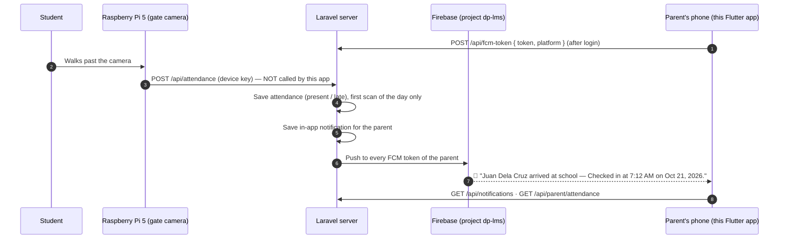

# Task for the Flutter app: parent "child arrived at school" notifications

> Paste this whole file into the Claude Code session of the Flutter project (`dp_lms`).
> Backend: Laravel `dp-lms-web`. Every endpoint and JSON sample below was verified against the
> running server on 2026-10-21 (end-to-end test: Pi scan → server → parent notification → parent API).
> Read together with `FLUTTER_HANDOFF.md` and `IOT_ARRIVAL_NOTIFICATIONS.md` if you have them.

---

## 0. Before writing code

1. **Search the project first** for `firebase_messaging`, `flutter_local_notifications`, `dp_lms_channel`,
   `fcm-token` and any notification/attendance screens. **Extend what exists — do not create a second
   FCM setup or duplicate services.** Follow the project's existing patterns (state management, HTTP client,
   routing, folder structure).
2. Check `pubspec.yaml` versions. The reference code in §6 is a guide — adapt it to the installed versions
   of `firebase_messaging` and `flutter_local_notifications` (their APIs changed between major versions).
3. `android/app/google-services.json` **must belong to the Firebase project with ID `dp-lms`** — the server
   sends pushes through that project. A different Firebase project = pushes never arrive.

---

## 1. What happens (the whole flow)



The app's job: **(a)** register the phone's FCM token, **(b)** show the push (also when the app is open),
**(c)** open the right screen when tapped, **(d)** list notifications and attendance history,
**(e)** unregister the token on logout.

---

## 2. API rules (same as the rest of the app)

| Item | Value |
|---|---|
| Base URL | `{APP_URL}/api` |
| Auth | `Authorization: Bearer {token}` (Sanctum, from login / parent activate) |
| Always send | `Accept: application/json` |
| Parent login | `POST /api/login` with key **`email`** — accepts email **or** mobile `09XXXXXXXXX` |

Show server `message` / `errors.*` text directly; do not hard-code your own versions.

---

## 3. Endpoints this feature uses

### 3.1 Register the phone — `POST /api/fcm-token` (any logged-in role)

Request: `{ "token": "<FCM registration token>", "platform": "android" }` (`platform` optional, max 20 chars; use `"android"` / `"ios"`)

Response `200`: `{ "status": "ok" }`

- Call **after every successful login / parent activation / parent recover**, and on **`onTokenRefresh`**.
- Safe to call repeatedly (server upserts by token; if the same phone logs in as another user, the token moves to that user).

### 3.2 Unregister on logout — `DELETE /api/fcm-token`

Request: `{ "token": "<same FCM token>" }` (JSON body; `?token=...` query string also works)

Response `200`: `{ "status": "ok" }`

- Call this **BEFORE** `POST /api/logout` — logout deletes the Bearer token, after which this call returns `401`.
- If it fails (offline), still log out locally.

### 3.3 Notification list — `GET /api/notifications`

Returns the latest 50 (read and unread) + unread count. Verified response:

```json
{
  "unread": 1,
  "items": [
    {
      "id": "611fe177-c703-41e1-b1d2-8ff4d9e2f565",
      "type": "arrival",
      "title": "Juan Dela Cruz arrived at school",
      "data": {
        "title": "Juan Dela Cruz arrived at school",
        "subject": "Late",
        "instructor": "Oct 21, 2026 1:10 PM",
        "type": "arrival",
        "url": "/parent/child-records",
        "student_id": 90,
        "student_name": "Juan Dela Cruz",
        "status": "late",
        "attended_at": "2026-10-21T13:10:21+08:00",
        "attendance_id": 4
      },
      "read": false,
      "created_at": "2026-10-21T13:10:21+08:00",
      "time": "0 seconds ago"
    }
  ]
}
```

- `id` is a **UUID string**, not an int.
- For `type == "arrival"` use `data.student_name`, `data.status` (`present` | `late`) and `data.attended_at`
  (ISO-8601 with `+08:00`; format it as local time, e.g. "7:12 AM · Oct 21"). Ignore `subject`/`instructor`/`url`
  (they exist for the web bell).
- Other `type` values may appear (e.g. `module`, `activity`, and **`class_attendance`** / **`attendance_open`** —
  see `FLUTTER_PROMPT_CLASS_ATTENDANCE.md`). Show unknown ones generically with `title`; never crash on an unknown type.

### 3.4 Mark as read

- `POST /api/notifications/{id}/read` → `{ "ok": true }` (`404` if the id is not the user's)
- `POST /api/notifications/read-all` → `{ "ok": true }`

### 3.5 Attendance history — `GET /api/parent/attendance?days=30` (parent role only)

`days` = 1–180 (default 30). One entry per linked child. Verified response:

```json
[
  {
    "student_id": 90,
    "student_name": "Juan Dela Cruz",
    "records": [
      { "id": 4, "status": "late", "attended_at": "2026-10-21T13:10:21+08:00", "date": "2026-10-21", "time": "1:10 PM" }
    ]
  }
]
```

- Newest first. A day with no record = the child was not scanned that day (absent or not yet arrived).
- `[]` (empty array) = no linked child yet.

---

## 4. The push message (exactly what FCM delivers)

```json
{
  "notification": {
    "title": "Juan Dela Cruz arrived at school",
    "body": "Checked in at 7:12 AM on Oct 21, 2026."
  },
  "data": {
    "type": "arrival",
    "student_id": "90",
    "student_name": "Juan Dela Cruz",
    "status": "present",
    "attended_at": "2026-10-21T07:12:03+08:00",
    "attendance_id": "4"
  },
  "android": { "priority": "high", "notification": { "channel_id": "dp_lms_channel", "sound": "default" } }
}
```

- For late arrivals the body reads `Checked in at 7:45 AM (late) on Oct 21, 2026.`
- **All `data` values are strings** (FCM rule) — parse `student_id` / `attendance_id` with `int.tryParse`.
- It contains a `notification` block, so when the app is in the **background or closed, Android shows it
  automatically** in channel `dp_lms_channel`. When the app is **open (foreground), FCM does NOT display it —
  the app must show it** with `flutter_local_notifications`.

---

## 5. When the parent gets NO push (not a bug)

| Situation | Reason |
|---|---|
| Second or later scan of the same child on the same day | One arrival per child per day |
| Parent account is `pending` (not yet verified by admin) | Unverified parents get nothing |
| Child not linked to the parent | Nobody to notify |
| Phone never sent its token (`POST /api/fcm-token`) | In-app list still has it (`/api/notifications`), no push |
| Notifications disabled / denied on the phone | Android permission (Android 13+) |
| `google-services.json` from another Firebase project | Server sends through project `dp-lms` |

---

## 6. Implementation steps

1. **Packages:** `firebase_core`, `firebase_messaging`, `flutter_local_notifications` (reuse if already present).
2. **Init (in `main()`):** `await Firebase.initializeApp();` then register a **top-level** background handler
   annotated `@pragma('vm:entry-point')` via `FirebaseMessaging.onBackgroundMessage(...)` (keep it minimal — the
   system already displays the notification; do not show a second one there).
3. **Android channel:** create channel id **`dp_lms_channel`** (name e.g. "DP-LMS", importance **high**) with
   `flutter_local_notifications` at startup. `AndroidManifest.xml`: `<uses-permission android:name="android.permission.POST_NOTIFICATIONS"/>`
   and optionally `<meta-data android:name="com.google.firebase.messaging.default_notification_channel_id" android:value="dp_lms_channel"/>`.
4. **Permission:** call `FirebaseMessaging.instance.requestPermission()` after login (covers Android 13+ and iOS).
   If denied, show a small banner on the parent home: "Turn on notifications to know when your child arrives."
5. **Token:** after login/activation → `getToken()` → `POST /api/fcm-token`. Listen to `onTokenRefresh` and POST
   again while logged in. Keep the last token in memory/secure storage so logout can send it.
6. **Foreground:** `FirebaseMessaging.onMessage.listen` → show it with `flutter_local_notifications` using
   `dp_lms_channel`, put `jsonEncode(message.data)` in the payload, and **refresh** the notification list /
   attendance screen / unread badge if they are visible.
7. **Tap handling** — route `data.type == "arrival"` to the parent **Attendance** screen (select the child with
   `student_id`), anything else to the **Notifications** screen. Handle all three entry points:
   `FirebaseMessaging.instance.getInitialMessage()` (app was closed), `FirebaseMessaging.onMessageOpenedApp`
   (app in background), and the local-notification tap callback (foreground notification, read the payload).
   On open, call `POST /api/notifications/read-all` or mark the specific one read when the list loads.
8. **Screens (parent):**
   - **Notifications**: `GET /api/notifications`, unread badge = `unread`, pull-to-refresh, tap → mark read.
     Arrival tile: child name, "On time" (green) / "Late" (amber), local time from `attended_at`.
   - **Attendance**: `GET /api/parent/attendance?days=30`, one section per child, rows `date` + `time` + status chip,
     pull-to-refresh; empty state "No arrivals recorded in the last 30 days."
9. **Logout:** `DELETE /api/fcm-token` (with the token) → then `POST /api/logout` → clear local data.

Reference (adapt to installed versions):

```dart
const dpChannel = AndroidNotificationChannel(
  'dp_lms_channel', 'DP-LMS',
  description: 'School notifications (arrivals, activities)',
  importance: Importance.high,
);

@pragma('vm:entry-point')
Future<void> firebaseBackgroundHandler(RemoteMessage message) async {
  await Firebase.initializeApp(); // nothing else — Android already shows the notification
}

// DateFormat comes from package:intl (add it if the project doesn't have it yet)
String arrivalSubtitle(Map<String, dynamic> data) {
  final at = DateTime.tryParse(data['attended_at']?.toString() ?? '')?.toLocal();
  final status = data['status'] == 'late' ? 'Late' : 'On time';
  return at == null ? status : '$status · ${DateFormat('h:mm a · MMM d').format(at)}';
}
```

---

## 7. Do NOT

- Do **not** call `POST /api/attendance` or `GET /api/faces/approved` from the app — those are for the Raspberry Pi
  and need the device key. **Never put `X-Device-Key` / `ATTENDANCE_DEVICE_KEY` in the app.**
- Do not rename JSON keys, and do not assume `data` values in the push are ints.
- Do not show a second notification from the background handler (duplicate notifications).
- Do not block login if token registration fails — log it and continue.

---

## 8. How to test (with the backend team)

1. Parent account must be **approved** and **linked** to the student; log in on a real Android phone; allow notifications.
2. Confirm the token reached the server (backend: `fcm_tokens` table has a row for the parent).
3. Simulate the Raspberry Pi (backend side, the key stays on the server/Pi):
   ```bash
   curl -X POST "{APP_URL}/api/attendance" \
     -H "Accept: application/json" \
     -H "X-Device-Key: <ATTENDANCE_DEVICE_KEY>" \
     -d "student_id=<student's email>"
   ```
   Expected: `{"success":true,"message":"Attendance recorded!",...}` and the phone shows the notification
   in all three states: app open, in background, closed.
4. Only the **first** scan per child per day notifies. To repeat on a local server:
   `php artisan tinker --execute="App\Models\Attendance::whereDate('attended_at', today())->delete();"`

## 9. Done when

- [ ] Token is registered after login and on refresh; removed on logout (before `/api/logout`)
- [ ] Push shows when the app is closed, in background, **and** open
- [ ] Tapping an arrival opens the Attendance screen for that child
- [ ] Notifications screen: list, unread badge, mark read, pull-to-refresh, unknown types don't crash
- [ ] Attendance screen: per child, newest first, empty state
- [ ] No crash when `items` / `records` are empty or the parent has no linked child
- [ ] No device key anywhere in the app
