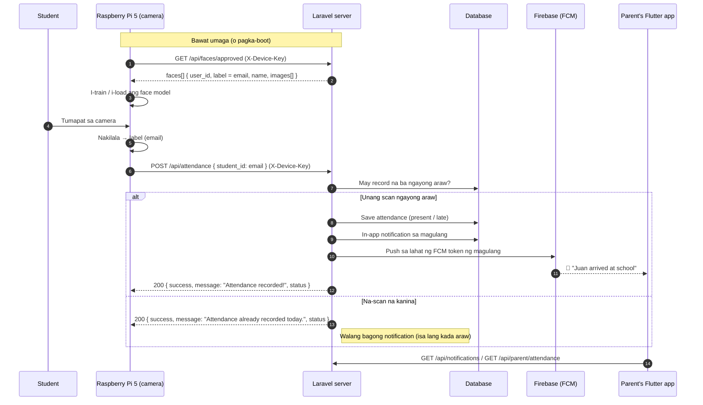
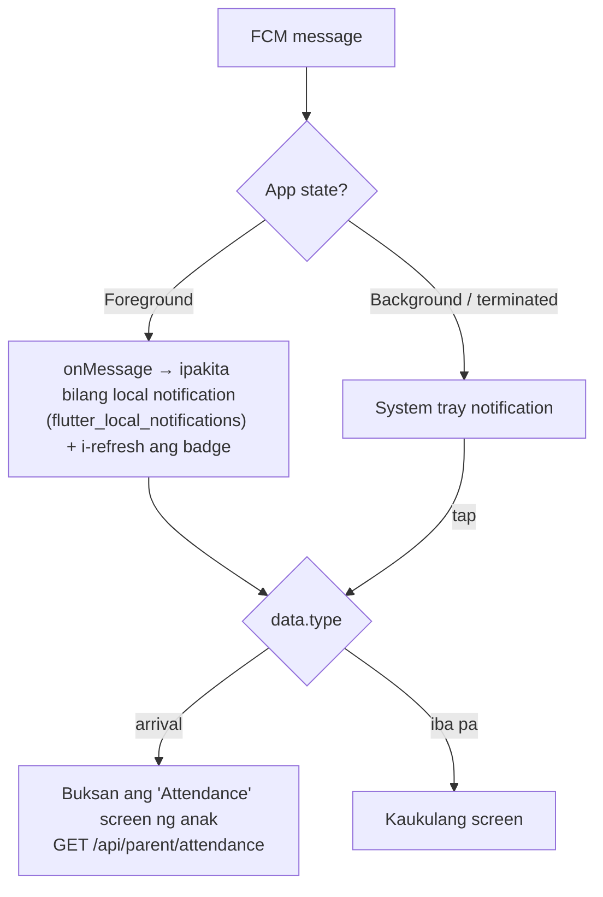

# Arrival notifications — Raspberry Pi 5 → Server → Parent's Flutter app

Para sa: Flutter developer (o Claude Code session) ng `dp_lms` app, at sa gumagawa ng Raspberry Pi script.
Backend: `dp-lms-web` (Laravel). Basahin kasama ng `FLUTTER_HANDOFF.md`.

> **Pagre-register ng mukha:** sa Raspberry Pi kiosk na gamit ang one-time QR mula sa adviser/admin —
> tingnan ang `RASPBERRY_PI_FACE_KIOSK.md` at `docs/raspberry-pi/face_kiosk.py`. Ang mga mukhang na-register
> doon ay **approved agad** at lumalabas sa `GET /api/faces/approved`.

> **Ano ang nangyayari:** tumapat ang estudyante sa camera ng Raspberry Pi 5 sa gate →
> nakilala ang mukha → nag-POST ang Pi sa server → na-save ang attendance →
> **agad na push notification sa phone ng magulang**: *"Juan Dela Cruz arrived at school —
> Checked in at 7:12 AM on Oct 21, 2026."*

---

## 1. Buong daloy



### Kailan **walang** notification na ipapadala

| Sitwasyon | Bakit |
|---|---|
| Pangalawa o higit pang scan sa parehong araw | Isa lang kada estudyante kada araw (dedupe) |
| Walang naka-link na magulang ang estudyante | Walang padadalhan |
| Ang magulang ay `pending` pa (hindi pa na-verify ng admin) | Hindi pa puwedeng makita ang records ng anak |
| Hindi nakilala ang `student_id` (walang tugmang estudyante) | Naka-save ang attendance pero walang `user_id` |
| Walang naka-register na FCM token ang magulang | In-app notification lang (`/api/notifications`) — walang push |

---

## 2. Raspberry Pi — API contract

Lahat ng request: header **`X-Device-Key: <ATTENDANCE_DEVICE_KEY>`** (parehong value sa server `.env`/Railway variables at sa `config.py` ng Pi). Throttle: 120 request/min kada IP.

> **(2026-10-21) Fail-closed na:** kapag walang `ATTENDANCE_DEVICE_KEY` sa server, bukas lang ito kapag
> `APP_ENV=local` (XAMPP). Sa production (Railway, `APP_ENV=production`) → **`401 Unauthorized device`**
> hangga't hindi naitatakda ang key. Dati bukas sa lahat — kahit sino ay makakapag-post ng pekeng arrival.

### `GET /api/faces/approved`

```json
{
  "faces": [
    {
      "user_id": 12,
      "label": "juan@gmail.com",
      "name": "Juan Dela Cruz",
      "reviewed_at": "2026-10-20T09:15:00+08:00",
      "images": ["https://.../storage/faces/12/img_01.jpg", "..."]
    }
  ]
}
```
Gamitin ang **`label`** (email) bilang ID ng mukha sa model.

### `POST /api/attendance`

```json
{ "student_id": "juan@gmail.com", "student_name": "Juan Dela Cruz", "section_id": null }
```

| Field | Rule |
|---|---|
| `student_id` | required — ang `label` (email) mula sa `/api/faces/approved`; tinatanggap din ang numeric user ID |
| `student_name` | optional |
| `section_id` | optional; dapat umiiral na section ID — **mas mabuting huwag ipadala** (kinukuha ng server sa account) |

| Response | Body |
|---|---|
| `200` (bagong record) | `{ "success": true, "message": "Attendance recorded!", "student": "Juan Dela Cruz", "status": "present" \| "late" }` |
| `200` (na-scan na) | `{ "success": true, "message": "Attendance already recorded today.", "student": "...", "status": "..." }` |
| `401` | `{ "success": false, "message": "Unauthorized device." }` — maling o walang `X-Device-Key` |
| `422` | Validation (hal. walang `student_id`, o maling `section_id`) |

- **Late:** kapag ang scan ay lampas sa `ATTENDANCE_LATE_AFTER` (default `07:30`, Asia/Manila).
- Ang Pi ay puwedeng mag-retry nang ligtas — hindi magdodoble ang record o ang notification.

### Halimbawa (Python sa Pi)

```python
import requests

API = "https://<your-domain>/api/attendance"
HEADERS = {"X-Device-Key": DEVICE_KEY, "Accept": "application/json"}

def report_arrival(label: str, name: str | None = None) -> None:
    try:
        r = requests.post(API, json={"student_id": label, "student_name": name},
                          headers=HEADERS, timeout=5)
        data = r.json()
        print(r.status_code, data.get("message"), data.get("status"))
    except requests.RequestException as e:
        # I-queue at subukan ulit mamaya (ligtas — may dedupe ang server)
        print("network error:", e)
```

> Para iwas-spam sa camera mismo: huwag i-POST ang parehong `label` nang paulit-ulit
> sa loob ng ~60 segundo (local cooldown). Ligtas pa rin kung mangyari — dedupe ang server.

---

## 3. Flutter (parent app) — ano ang kailangan

### 3.1 FCM token — DAPAT naka-register

Pagka-login (at tuwing magbabago ang token):

```dart
final token = await FirebaseMessaging.instance.getToken();
await api.post('/api/fcm-token', {'token': token, 'platform': Platform.isIOS ? 'ios' : 'android'});

FirebaseMessaging.instance.onTokenRefresh.listen((t) =>
    api.post('/api/fcm-token', {'token': t, 'platform': Platform.isIOS ? 'ios' : 'android'}));
```

Pag-logout: `DELETE /api/fcm-token { token }` — para hindi na makatanggap ang lumang phone.

### 3.2 Push payload (FCM v1)

```json
{
  "notification": {
    "title": "Juan Dela Cruz arrived at school",
    "body": "Checked in at 7:12 AM on Oct 21, 2026."
  },
  "data": {
    "type": "arrival",
    "student_id": "12",
    "student_name": "Juan Dela Cruz",
    "status": "present",
    "attended_at": "2026-10-21T07:12:44+08:00",
    "attendance_id": "345"
  },
  "android": { "priority": "high", "notification": { "channel_id": "dp_lms_channel" } }
}
```

- **Lahat ng `data` value ay string** (FCM rule) — i-parse ang `student_id`/`attendance_id` gamit ang `int.parse`.
- `status`: `present` o `late` — puwedeng iba ang kulay/icon sa UI.
- Android channel: **`dp_lms_channel`** (kapareho ng ibang notification ng app; importance high).

### 3.3 Pag-handle sa app



```dart
FirebaseMessaging.onMessage.listen((m) {
  if (m.data['type'] == 'arrival') {
    showLocalNotification(m.notification?.title, m.notification?.body, payload: m.data);
    ref.invalidate(notificationsProvider);   // Riverpod: i-refresh ang listahan/badge
  }
});

FirebaseMessaging.onMessageOpenedApp.listen((m) => routeFromPush(m.data));
final initial = await FirebaseMessaging.instance.getInitialMessage();
if (initial != null) routeFromPush(initial.data);

void routeFromPush(Map<String, dynamic> d) {
  if (d['type'] == 'arrival') {
    router.push('/parent/attendance?student=${d['student_id']}');
  }
}
```

### 3.4 Mga bagong endpoint (Sanctum token)

#### `GET /api/notifications` — notification inbox (lahat ng role)

```json
{
  "unread": 2,
  "items": [
    {
      "id": "9b1c…uuid",
      "type": "arrival",
      "title": "Juan Dela Cruz arrived at school",
      "data": {
        "type": "arrival",
        "student_id": 12,
        "student_name": "Juan Dela Cruz",
        "status": "present",
        "attended_at": "2026-10-21T07:12:44+08:00",
        "attendance_id": 345,
        "subject": "On time",
        "instructor": "Oct 21, 2026 7:12 AM",
        "url": "/parent/child-records"
      },
      "read": false,
      "created_at": "2026-10-21T07:12:45+08:00",
      "time": "2 minutes ago"
    }
  ]
}
```

- `POST /api/notifications/{id}/read` → `{ ok: true }`
- `POST /api/notifications/read-all` → `{ ok: true }`

#### `GET /api/parent/attendance?days=30` — arrival history (1–180 araw)

```json
[
  {
    "student_id": 12,
    "student_name": "Juan Dela Cruz",
    "records": [
      { "id": 345, "status": "present", "attended_at": "2026-10-21T07:12:44+08:00", "date": "2026-10-21", "time": "7:12 AM" },
      { "id": 331, "status": "late",    "attended_at": "2026-10-20T07:41:02+08:00", "date": "2026-10-20", "time": "7:41 AM" }
    ]
  }
]
```

Walang record sa isang araw ng klase = hindi pa nag-scan (posibleng absent o hindi pa dumarating).

### 3.5 Mga screen na gagawin

- [ ] **Notifications inbox** (`GET /api/notifications`) — badge = `unread`
- [ ] **Child attendance** (`GET /api/parent/attendance`) — listahan kada araw, may kulay ang `late`
- [ ] Parent home: card na "Arrived today at 7:12 AM" (kunin ang unang record ngayong araw)
- [ ] FCM: register token pagka-login, unregister pagka-logout, `onMessage` / `onMessageOpenedApp` / `getInitialMessage`
- [ ] Android: tiyaking umiiral ang channel `dp_lms_channel` (importance high) at may `POST_NOTIFICATIONS` permission (Android 13+)

---

## 4. Pagsubok (end-to-end)

1. Server: itakda ang `ATTENDANCE_DEVICE_KEY` sa `.env` (local) o Railway variables.
2. Siguraduhing may **naka-link at approved na magulang** ang estudyante, at naka-login ang magulang sa app (may FCM token).
3. I-simulate ang Pi scan:

```bash
curl -X POST https://<your-domain>/api/attendance \
  -H "X-Device-Key: <key>" -H "Accept: application/json" -H "Content-Type: application/json" \
  -d '{"student_id":"juan@gmail.com"}'
```

4. Inaasahan: `200 "Attendance recorded!"` → push sa phone ng magulang sa loob ng ilang segundo.
5. Ulitin ang curl → `"Attendance already recorded today."` at **walang** pangalawang push.

> Firebase credentials ng server: `FIREBASE_CREDENTIALS_BASE64` (Railway) o
> `storage/app/firebase/firebase-service-account.json` (local). Kung wala, in-app notification lang ang gagana.
