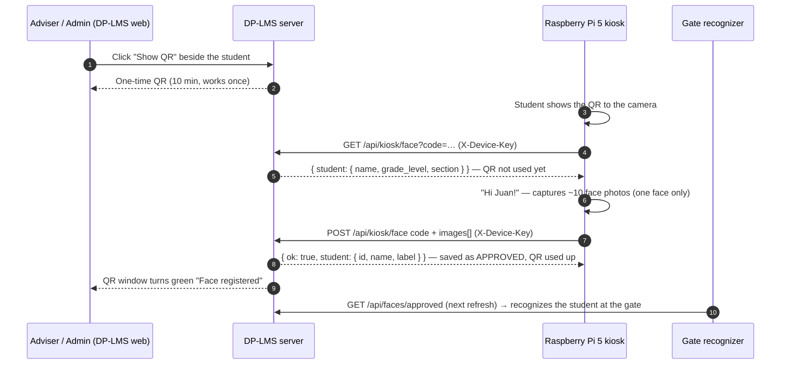

# Raspberry Pi 5 — Face registration kiosk

For: whoever sets up the Raspberry Pi 5 (camera) for DP-LMS.
Goal: register each student's face **at the Pi**, so the school-gate camera can recognize them and
their parents get "arrived at school" notifications (see `IOT_ARRIVAL_NOTIFICATIONS.md`).

Files: `docs/raspberry-pi/face_kiosk.py` and `docs/raspberry-pi/config.example.py`.

---

## 1. How it works



Where staff click "Show QR":
- **Adviser:** Teacher portal → **Face Registration** (only their own advisory students).
- **Admin:** Admin → **Face Verification** → "Register a face at the kiosk" → choose section.

Security built in: the QR is for one named student, expires in 10 minutes, works once; a new QR for the
same student cancels the old one; the server stores only a hash of it; every Pi call needs the device key.
Students with 3 face warnings are blocked.

---

## 2. One-time setup on the Pi (Raspberry Pi OS 64-bit, Bookworm or newer)

```bash
sudo apt update
sudo apt install -y python3-picamera2 python3-opencv opencv-data python3-requests   # opencv-data = face detector files
rpicam-hello -t 2000          # camera test (Pi 5 + Camera Module); you should see a preview
mkdir -p ~/dplms && cd ~/dplms
# copy face_kiosk.py and config.example.py here, then:
cp config.example.py config.py
nano config.py                # set API_BASE and DEVICE_KEY
python3 face_kiosk.py
```

`config.py`:

| Setting | Value |
|---|---|
| `API_BASE` | Server URL without trailing slash, e.g. `https://<your-railway-app>` |
| `DEVICE_KEY` | **Same** value as `ATTENDANCE_DEVICE_KEY` on the server (Railway variables). Long random string |
| `PHOTOS` | Photos per student (server accepts 3–15; default 10) |
| `SHOW_WINDOW` | `True` with a monitor attached; `False` for headless (messages print to the terminal) |
| `FULLSCREEN` | Full-screen, mirrored preview on the 5-inch display (default `True`) |
| `COLOR_FIX` | White balance for cameras without an IR filter — otherwise photos are violet (default `True`) |
| `SHARP_MIN` / `SHARP_GOOD` / `BRIGHT_MIN` | Photo quality gates (defaults 25 / 60 / 45). Lower `SHARP_MIN` only if clear faces keep getting "Hold still" |

Never commit `config.py` — it contains the device key.

**Server side (once):** set `ATTENDANCE_DEVICE_KEY` (and `APP_ENV=production`) in Railway. Without the key,
production refuses every device call with `401 Unauthorized device`.

---

## 3. Using it (at the kiosk)

1. Adviser opens **Face Registration**, taps **Show QR** beside the student.
2. Student holds the phone/laptop screen with the QR in front of the Pi camera (about 30–50 cm).
3. Screen shows **"Hi <name>!"** → student looks straight at the camera, alone in the frame, good light on the face.
   The screen says what to change: *Come a little closer · Move back a little · Move to the middle ·
   Only ONE face · More light on your face · Hold still*. Green text = photos are being taken.
4. The Pi keeps the sharpest ~10 photos (a one-frame false detection, blurry or dark frames are never used),
   corrects the colour and uploads them; the adviser's QR window turns **green**. Next student.

If "Not enough clear photos": the reason is shown (usually light or movement) — fix it and scan the same QR
again (it is still unused). If the QR expired: tap **Make a new QR**.

---

## 4. API contract (for custom scripts)

All requests: header `X-Device-Key: <key>` and `Accept: application/json`. Rate limit: 120 req/min (upload: 30/min).

### `GET /api/kiosk/face?code=<QR text>`
The QR text is exactly `DPLMS-FACE:` + 40 characters.

`200`
```json
{ "ok": true,
  "student": { "id": 147, "name": "Juan Dela Cruz", "grade_level": "7", "section": "CALIMLIM" },
  "expires_at": "2026-10-21T17:26:43+08:00", "min_images": 3, "max_images": 15 }
```
`422 { "ok": false, "message": "This QR code is invalid, already used, or expired. Ask your adviser for a new one." }` · `401` wrong key.

### `POST /api/kiosk/face` (multipart/form-data)
Fields: `code` = QR text, `images[]` = 3–15 files (JPEG/PNG, ≤ 2 MB each).

`200`
```json
{ "ok": true, "message": "Face registered for Juan Dela Cruz.",
  "student": { "id": 147, "name": "Juan Dela Cruz", "label": "juan@gmail.com" } }
```
- `label` is the ID the gate recognizer must use (same as `label` in `GET /api/faces/approved`, and the
  `student_id` it posts to `POST /api/attendance`).
- `422` with `errors.images` (too few/too many/not images) — the QR is **not** used, retry is allowed.
- `422 { ok:false, message }` — QR invalid/used/expired, or the student is not active.
- Saving replaces the student's previous photos only after the new ones are stored (a failed upload never
  deletes the old face).

---

## 5. Gate camera (`gate_camera.py`)

The same Pi and camera check students in at the entrance. A kiosk registration is already approved, and the
gate reloads the approved faces every `REFRESH_MINUTES` (and at start), so a new student is recognized the
same day.

**One-time setup** (in the folder with `face_kiosk.py` and `config.py`):

```bash
mkdir -p models && cd models
wget https://github.com/opencv/opencv_zoo/raw/main/models/face_detection_yunet/face_detection_yunet_2023mar.onnx
wget https://github.com/opencv/opencv_zoo/raw/main/models/face_recognition_sface/face_recognition_sface_2021dec.onnx
cd ..
DISPLAY=:0 python3 gate_camera.py
```

**What it does:** YuNet finds the face, SFace compares it with every approved student's photos. The same
student above `MATCH_THRESHOLD` on `MATCH_FRAMES` frames in a row → "Welcome, Juan!" with the time, then
On time / Late / Already checked in from the server, and the parent gets the arrival notification.
A face that matches nobody → "Not recognized" (logged with its score, no picture).

**No internet:** the gate keeps working with the faces it loaded last (saved in `face_cache/`, owner-only
permissions). Scans wait in `gate_queue.jsonl` with their real time and are sent, in order, when the server
is reachable; on-time/late is decided from the real time, not the time they arrived.

Measured on the laptop with the demo student's kiosk photos: same person 0.74–0.87, a different person
0.17–0.18. The default threshold 0.40 sits well between; raise it if a student is ever mistaken for
another, lower it if registered students often get "Not recognized".

Options in `config.py`: `DEVICE_NAME`, `MATCH_THRESHOLD`, `MATCH_FRAMES`, `UNKNOWN_FRAMES`, `GATE_FACE_MIN`,
`COOLDOWN_SECONDS`, `RESULT_SECONDS`, `REFRESH_MINUTES` (see `config.example.py`).

Not yet: liveness (a printed photo or a phone screen can still be recognized) — B9-12.

---

## 6. Troubleshooting

| Symptom | Fix |
|---|---|
| `Unauthorized device` | `DEVICE_KEY` in `config.py` ≠ `ATTENDANCE_DEVICE_KEY` on the server |
| Gate: `Missing model file(s)` | Download the two `.onnx` files into `models/` (section 5) |
| Gate: `Loading faces...` never ends | Server unreachable on first start and no `face_cache/` yet: check `API_BASE` and the network |
| Gate: a student is often "Not recognized" | Re-register at the kiosk in the gate's light, or lower `MATCH_THRESHOLD` a little (0.36 is OpenCV's reference) |
| QR never detected | More light, hold the screen still and flat, raise screen brightness, 30–50 cm away |
| "Only ONE face" stays on | Others in the background; ask them to step aside |
| `haarcascade_frontalface_default.xml not found` | `sudo apt install opencv-data` (Debian 13 / Raspberry Pi OS Trixie ships the XML files separately) |
| No window on the Pi screen when started over SSH | Start it as `DISPLAY=:0 python3 face_kiosk.py` |
| Photos evenly soft / "Hold still" although nobody moves | The lens is out of focus: `DISPLAY=:0 python3 focus_check.py`, turn the lens slowly and stop at the highest sharpness (face ~50 cm away) |
| Half of the face dark | Light from the side — put the light in front of the face (behind the camera) |
| Camera error | `rpicam-hello` must work first; check the ribbon cable and `sudo raspi-config` |
